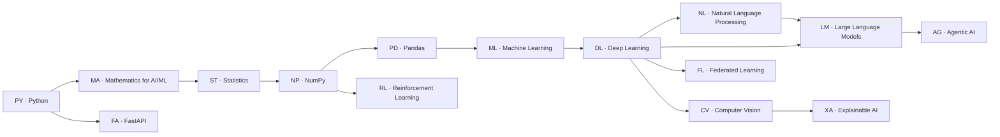

# Prerequisite and Coverage Map

Generated by `build/reports.py` on 2026-10-24. The path is defined in `build/path.py`; IDs are assigned from it.

## 1. Audit of the previous curriculum (168 packs)

Problems found before this revision, and fixed by it:

1. Python began with `def`, default arguments and f-strings; `print`, variables, types, `input`, operators, conditionals, `while` loops, files, modules, classes and testing had no lesson, yet later packs used classes (ML, DL, RL), decorators (Agentic AI), `heapq`/`deque`/`itertools`, `json` and regular expressions.
2. Logistic regression used the sigmoid before it was taught (it had been moved to Deep Learning), and the derivative rules behind backpropagation had no step; exponentials, logarithms and Σ notation were assumed.
3. Statistics had no probability, conditional-probability, Bayes, normal-distribution or standard-error lessons, although Naive Bayes, Welch's t and bootstrap intervals rely on them.
4. NumPy introduced `@` and vectorisation implicitly; pandas had no Series, CSV-reading, missing-value or date lessons before group-wise imputation and resampling.
5. Several packs sent learners to other topics or out of order: A* depended on CV connected components, PPMI (which builds word vectors) came after the embedding-analogy step that uses word vectors, and 12 packs listed two or more cross-topic prerequisites.
6. Difficulty bands were a fixed 4 beginner / 4 intermediate / 4 advanced split per topic rather than following the content (e.g. a list transpose was 'advanced' while exception handling was 'intermediate').
7. Library implementations were mostly mentioned in passing; no tests compared manual code with the library.
8. There was no FastAPI/HTTP topic and no RAG, chat-template, transformer-block, Adam, autograd or agent-evaluation step.
9. Validation claims named pandas 3 / NumPy 2.5 while the executor image pins pandas 2.2.3 / NumPy 2.2.6.

## 2. Topic prerequisites

Recommended order: Python → Mathematics for AI/ML → Statistics → NumPy → Pandas → FastAPI → Machine Learning → Deep Learning → Computer Vision → Natural Language Processing → Large Language Models → Explainable AI → Federated Learning → Reinforcement Learning → Agentic AI. FastAPI needs only Python; it is placed after pandas so the software-engineering steps come before machine learning.

## 3. Required coverage

Each required area and the steps that teach it.

### Python

| Area | Steps |
|---|---|
| print | PY-01 Hello, print() |
| variables | PY-02 Variables and f-strings |
| types and conversion | PY-03 Types and Conversion |
| operators | PY-05 Arithmetic Operators, PY-02 Variables and f-strings |
| input | PY-04 Reading Input |
| conditionals | PY-07 Conditionals: Letter Grades |
| loops | PY-08 While Loops: Read Until Done, PY-09 For Loops and range: FizzBuzz |
| strings | PY-06 Strings: Indexing, Slicing and Methods, PY-10 Greeting Formatter |
| collections | PY-11 Sum and Mean of a List, PY-12 Filter Even Numbers, PY-13 Vowel Counter, PY-14 Fibonacci Sequence, PY-16 Unique Words in Order |
| functions | PY-10 Greeting Formatter, PY-17 Functions as Values |
| files | PY-23 Files, CSV and JSON, PY-24 Text Statistics from stdin |
| exceptions | PY-19 Validated Factorial, PY-21 Safe Division with Exceptions |
| modules | PY-15 Importing the Standard Library, PY-24 Text Statistics from stdin |
| classes | PY-25 Classes: A Bank Account, PY-26 Inheritance, Special Methods and Dataclasses |
| testing | PY-27 Writing Unit Tests |

### Mathematics

| Area | Steps |
|---|---|
| notation (Σ, Π) | MA-01 Summation and Product Notation |
| exponentials and logarithms | MA-02 Exponentials and Logarithms |
| sigmoid | MA-03 The Sigmoid Function |
| vectors | MA-04 Dot Product, MA-05 Vector Norm and Unit Vector |
| matrices | MA-06 Matrix Multiplication, MA-08 Solve a 2x2 System (Cramer's Rule), MA-09 Inverse of a 2x2 Matrix |
| counting | MA-07 Binomial Coefficient |
| derivatives and chain rule | MA-10 Numerical Derivative (Central Difference), MA-11 Derivative Rules and the Chain Rule |
| integration | MA-12 Trapezoidal Integration |
| optimisation | MA-13 Gradient Descent in 1D, MA-14 Numerical Gradient of f(x1..xn) |
| series and eigenvectors | MA-15 Taylor Series for exp(x), MA-16 Dominant Eigenvalue by Power Iteration |

### Statistics

| Area | Steps |
|---|---|
| descriptive statistics | ST-01 Mean and Variance (Population vs Sample), ST-02 Median and Mode, ST-03 Percentiles by Linear Interpolation, ST-04 Histogram with Equal-Width Bins, ST-05 Standardize to z-scores |
| probability | ST-06 Probability by Counting Outcomes, ST-07 Conditional Probability and Bayes' Rule |
| distributions | ST-08 Binomial Probabilities, ST-09 The Normal Distribution |
| simulation and sampling | ST-10 Dice Simulation and the Law of Large Numbers, ST-12 Sampling Distributions and Standard Error |
| association | ST-11 Covariance and Pearson Correlation |
| inference | ST-13 Bootstrap Confidence Interval, ST-16 Chi-Square Goodness of Fit by Hand, ST-18 Welch's t-statistic by Hand, ST-20 Permutation Test for a Mean Difference by Hand |

### NumPy

| Area | Steps |
|---|---|
| arrays and vectorisation | NP-01 Create an Array and Inspect It, NP-02 Vectorised Arithmetic and ufuncs |
| indexing | NP-03 Slicing a Sub-grid, NP-04 Boolean Masks, NP-09 Fancy Indexing and Gather |
| reductions and broadcasting | NP-05 Aggregations Along Axes, NP-07 Centering Columns with Broadcasting |
| linear algebra | NP-06 Matrix Products with @, NP-12 Solve Linear Systems Safely, NP-11 Vectorized Pairwise Distances |
| shapes, randomness, encodings | NP-08 Reshape and Stack, NP-10 Seeded Random Generators, NP-13 One-Hot Encoding, NP-14 Moving Average with cumsum |

### pandas

| Area | Steps |
|---|---|
| Series and DataFrames | PD-01 Series: Labelled Columns, PD-02 Build and Describe a DataFrame |
| reading and writing | PD-03 Reading and Writing CSV |
| selection and derived columns | PD-04 Select and Filter Rows, PD-05 Derived Columns, PD-07 Sort and Rank |
| missing values | PD-06 Finding and Handling Missing Values, PD-09 Fill Missing Values by Group |
| grouping and joining | PD-08 Group-by Aggregation, PD-10 Merging Tables |
| text and dates | PD-11 Cleaning Text Columns, PD-12 Working with Dates, PD-13 Weekly Resampling |
| reshaping and windows | PD-14 Pivot Tables, PD-15 Binning with pd.cut, PD-16 Rolling-Window Features |

### FastAPI

| Area | Steps |
|---|---|
| HTTP fundamentals | FA-01 Anatomy of an HTTP Request, FA-02 HTTP Responses and Status Codes, FA-03 URLs, Paths and Query Strings, FA-04 JSON Request Bodies and Validation |
| routes | FA-05 A Router by Hand, FA-08 First FastAPI Routes |
| validation | FA-09 Query and Path Parameters with Validation, FA-10 Request Bodies with Pydantic |
| errors | FA-11 Handling Errors in FastAPI, FA-12 Response Models and Status Codes |
| dependencies | FA-13 Dependencies and Dependency Overrides |
| async behaviour | FA-06 async and await with asyncio, FA-07 A Minimal ASGI Application, FA-14 Async Endpoints and External Services |
| API testing | FA-15 Testing an API |

### Machine Learning

| Area | Steps |
|---|---|
| supervised-learning vocabulary and baselines | ML-01 Features, Labels and Baseline Models |
| splits and metrics | ML-05 Seeded Train/Test Split, ML-03 Regression Metrics, ML-06 Confusion Matrix, Precision, Recall, F1 |
| preprocessing | ML-08 Standard Scaler (fit on train only) |
| linear models | ML-09 Least-Squares Line, ML-10 Linear Regression by Gradient Descent, ML-11 Logistic Regression from Scratch, ML-20 Ridge Regression (Closed Form) |
| model selection | ML-15 Polynomial Features and Overfitting by Hand, ML-17 k-Fold Cross-Validation by Hand |
| other models | ML-13 k-Nearest Neighbors Classifier by Hand, ML-21 Decision Stump with Gini Impurity, ML-26 k-Means Clustering by Hand |

### Deep Learning

| Area | Steps |
|---|---|
| forward pass | DL-01 Activation Functions, DL-02 Numerically Stable Softmax, DL-03 Cross-Entropy Loss, DL-04 Dense Layer Forward Pass, DL-07 MLP Forward Pass |
| gradients | DL-08 A Tiny Autograd Engine, DL-10 Backprop Through One Neuron, DL-11 Backpropagation Through a Dense Layer, DL-13 Gradient Checking by Hand |
| training | DL-14 SGD with Momentum, DL-16 The Adam Optimiser, DL-19 Train an MLP on XOR |
| regularisation, normalisation, convolution | DL-21 Inverted Dropout, DL-23 Batch Normalization by Hand (train/eval), DL-25 1D Convolution by Hand (valid, stride) |

### Computer Vision

| Area | Steps |
|---|---|
| images as arrays | CV-01 Images as Arrays, CV-02 RGB to Grayscale, CV-05 Flip and Rotate |
| pixel operations | CV-07 Binary Thresholding, CV-09 Intensity Histogram |
| filtering and CNN layers | CV-10 2D Filtering (Blur), CV-12 Sobel Edge Magnitude, CV-14 2D Max Pooling, CV-15 A Convolution Layer with Channels |
| quality and geometry | CV-17 MSE and PSNR by Hand, CV-19 Bilinear Resize |
| detection post-processing | CV-23 Intersection over Union, CV-24 Non-Maximum Suppression, CV-26 Connected Components Labeling by Hand |

### NLP

| Area | Steps |
|---|---|
| text processing | NL-01 Regular Expressions for Text, NL-02 Tokenize and Normalize, NL-04 Stopwords and Word Counts, NL-06 Character n-grams by Hand, NL-13 Rule-Based Suffix Stemmer |
| representations | NL-07 Bag-of-Words Vectors, NL-08 Bigram Counts with Sentence Markers, NL-09 TF-IDF, NL-17 PPMI Co-occurrence Matrix, NL-18 Word Embedding Analogies |
| retrieval, distance, classification | NL-11 Cosine Similarity Retrieval, NL-12 Levenshtein Edit Distance, NL-14 Multinomial Naive Bayes Text Classifier |

### LLMs

| Area | Steps |
|---|---|
| tokens | LM-01 Vocabularies and Token IDs, LM-06 Byte-Pair Encoding Merges |
| language modelling and decoding | LM-02 Next-Token Probabilities (Add-k), LM-03 Logits, Temperature and Softmax, LM-04 Greedy Decoding, LM-05 Perplexity, LM-13 Top-k and Top-p Filtering, LM-14 Beam Search |
| transformers | LM-07 Scaled Dot-Product Attention, LM-08 Causal Masking, LM-09 Sinusoidal Positional Encoding, LM-10 Multi-Head Attention, LM-12 A Pre-Norm Transformer Block by Hand, LM-15 Incremental Decoding with a KV Cache |
| applications | LM-18 Chat Prompt Templates, LM-21 Retrieval-Augmented Generation by Hand |

### Explainable AI

| Area | Steps |
|---|---|
| intrinsic explanations | XA-01 Linear Model Contributions, XA-02 Ranking Attributions, XA-03 Tracing a Decision Path |
| model-agnostic methods | XA-04 Individual Conditional Expectation, XA-06 Partial Dependence by Hand, XA-08 Permutation Feature Importance by Hand, XA-09 Occlusion Saliency Map, XA-10 Global Surrogate and Fidelity, XA-11 Exact Shapley Values, XA-12 LIME-style Local Linear Explanation, XA-13 Minimal Counterfactual Search |
| gradient methods | XA-14 Integrated Gradients |

### Federated Learning

| Area | Steps |
|---|---|
| partitioning and aggregation | FL-01 IID Client Partitioning, FL-04 Label-Skewed (non-IID) Partition, FL-02 Weighted Federated Averaging, FL-03 Client Updates as Deltas |
| training | FL-06 Local SGD on a Client, FL-07 One FedAvg Round, FL-08 Seeded Client Sampling, FL-10 Full FedAvg Training Loop, FL-14 FedProx Local Objective |
| privacy and robustness | FL-09 Clipping Client Updates, FL-12 Secure Aggregation with Pairwise Masks, FL-13 Differentially Private Aggregation |

### Reinforcement Learning

| Area | Steps |
|---|---|
| returns and environments | RL-01 Discounted Return, RL-02 Gridworld Transition Function, RL-03 The Environment Interface: reset and step |
| bandits | RL-05 Epsilon-Greedy Action Selection, RL-06 Incremental Value Estimates, RL-07 UCB1 Bandit |
| dynamic programming | RL-08 Iterative Policy Evaluation, RL-09 Value Iteration, RL-10 Policy Iteration |
| learning from experience | RL-11 First-Visit Monte Carlo Prediction, RL-12 TD(0) Prediction, RL-13 Tabular Q-Learning, RL-15 SARSA |

### Agentic AI

| Area | Steps |
|---|---|
| tools and parsing | AG-01 Tool Registry and Dispatch, AG-02 Parsing Model Tool Calls |
| agent loops | AG-04 Perceive-Act Loop, AG-05 Goal Tests and Step Budgets, AG-06 ReAct Loop with a Scripted Model, AG-10 Conversation Memory Window by Hand |
| planning | AG-11 BFS Planner, AG-12 A* Planner, AG-13 Dependency-Ordered Plans |
| reliability and safety | AG-15 Validate-and-Retry Tool Calls, AG-17 Orchestrator-Workers Pipeline by Hand, AG-19 Permission Guardrails, AG-20 Evaluating Agents |

## 4. Step-by-step map

*Builds on* lists the step's prerequisites. *Introduces* lists the Python constructs, imports and library calls whose first allowed use is this step (checked by `build/audit.py`).

### PY · Python

| ID | Step | Difficulty | Builds on | Introduces | Concepts |
|---|---|---|---|---|---|
| PY-01 | Hello, print() | beginner | — | print | print, strings, comments, sep-end |
| PY-02 | Variables and f-strings | beginner | PY-01 | assignment, f-string | variables, assignment, f-strings, naming |
| PY-03 | Types and Conversion | beginner | PY-02 | conversion | types, int, float, str, bool, conversion |
| PY-04 | Reading Input | beginner | PY-03 | input | input, stdin, conversion, strip |
| PY-05 | Arithmetic Operators | beginner | PY-04 | arithmetic | operators, integer-division, modulo, precedence, formatting |
| PY-06 | Strings: Indexing, Slicing and Methods | beginner | PY-05 | subscript | strings, indexing, slicing, string-methods |
| PY-07 | Conditionals: Letter Grades | beginner | PY-06 | if, boolean-logic | conditionals, if-elif-else, comparisons, boolean-logic |
| PY-08 | While Loops: Read Until Done | beginner | PY-07 | while | while, break, sentinel, accumulator |
| PY-09 | For Loops and range: FizzBuzz | beginner | PY-08 | for | for, range, iteration, fizzbuzz |
| PY-10 | Greeting Formatter | beginner | PY-09 | def | functions, strings, f-strings, default-arguments |
| PY-11 | Sum and Mean of a List | beginner | PY-10 | list | loops, accumulator, tuples, edge-cases |
| PY-12 | Filter Even Numbers | beginner | PY-11 | comprehension, generator-expression | list-comprehension, modulo, filtering |
| PY-13 | Vowel Counter | beginner | PY-12 | dict | strings, dictionaries, counting, membership |
| PY-14 | Fibonacci Sequence | intermediate | PY-13 | tuple-unpacking | loops, sequences, tuple-unpacking, state |
| PY-15 | Importing the Standard Library | intermediate | PY-14 | import, import math, import random, import string, import collections, import itertools, import heapq, import functools, import statistics, import copy | modules, import, math, random, collections, heapq, itertools |
| PY-16 | Unique Words in Order | intermediate | PY-15 | set | sets, strings, deduplication, order-preservation |
| PY-17 | Functions as Values | intermediate | PY-16 | lambda, varargs, keyword-only, decorator, nested-function | higher-order-functions, lambda, args-kwargs, decorators, closures |
| PY-18 | Gradebook Aggregation | intermediate | PY-17 | — | dictionaries, grouping, sorting, lambda |
| PY-19 | Validated Factorial | intermediate | PY-18 | raise | exceptions, validation, loops, integers |
| PY-20 | Matrix Transpose with Validation | intermediate | PY-19 | — | nested-lists, list-comprehension, zip, validation |
| PY-21 | Safe Division with Exceptions | intermediate | PY-20 | try | exceptions, try-except, error-handling, batch-processing |
| PY-22 | Guessing Game Feedback | advanced | PY-21 | — | loops, break, state-machines, validation |
| PY-23 | Files, CSV and JSON | advanced | PY-22 | with, import json, import csv, import pathlib, import os, import io | files, with, pathlib, csv, json |
| PY-24 | Text Statistics from stdin | advanced | PY-23 | import sys | stdin, io, strings, program-structure |
| PY-25 | Classes: A Bank Account | advanced | PY-24 | class | classes, objects, methods, state, repr |
| PY-26 | Inheritance, Special Methods and Dataclasses | advanced | PY-25 | inheritance, import dataclasses, import typing | inheritance, polymorphism, super, dunder-methods, dataclasses |
| PY-27 | Writing Unit Tests | advanced | PY-26 | import unittest | testing, unittest, edge-cases, mutation-testing, mocks |

### MA · Mathematics for AI/ML

| ID | Step | Difficulty | Builds on | Introduces | Concepts |
|---|---|---|---|---|---|
| MA-01 | Summation and Product Notation | beginner | PY-17 | — | summation, sigma-notation, product-notation, floating-point |
| MA-02 | Exponentials and Logarithms | beginner | MA-01 | — | exponential, logarithm, log-likelihood, underflow, log-sum-exp |
| MA-03 | The Sigmoid Function | beginner | MA-02 | — | sigmoid, logistic-function, logit, numerical-stability |
| MA-04 | Dot Product | beginner | MA-01 | — | vectors, dot-product, linear-algebra |
| MA-05 | Vector Norm and Unit Vector | beginner | MA-04 | — | vectors, norms, normalisation |
| MA-06 | Matrix Multiplication | beginner | MA-04, PY-20 | — | matrices, matrix-multiplication, shapes |
| MA-07 | Binomial Coefficient | intermediate | MA-01, PY-19 | — | combinatorics, counting, integers |
| MA-08 | Solve a 2x2 System (Cramer's Rule) | intermediate | MA-06 | — | linear-systems, determinant, cramers-rule, floating-point |
| MA-09 | Inverse of a 2x2 Matrix | intermediate | MA-08 | — | matrix-inverse, determinant, identity |
| MA-10 | Numerical Derivative (Central Difference) | intermediate | MA-02 | — | calculus, derivatives, finite-differences, numerical-methods |
| MA-11 | Derivative Rules and the Chain Rule | intermediate | MA-10, MA-03 | — | derivatives, chain-rule, product-rule, calculus, backpropagation |
| MA-12 | Trapezoidal Integration | intermediate | MA-10 | — | calculus, integration, numerical-methods |
| MA-13 | Gradient Descent in 1D | advanced | MA-11 | — | optimisation, gradient-descent, learning-rate, convergence |
| MA-14 | Numerical Gradient of f(x1..xn) | advanced | MA-10, MA-13 | — | multivariable-calculus, gradient, partial-derivatives, optimisation |
| MA-15 | Taylor Series for exp(x) | advanced | MA-11, MA-07 | — | series, approximation, taylor, convergence |
| MA-16 | Dominant Eigenvalue by Power Iteration | advanced | MA-05, MA-06 | — | eigenvalues, linear-algebra, iterative-methods, pca |

### ST · Statistics

| ID | Step | Difficulty | Builds on | Introduces | Concepts |
|---|---|---|---|---|---|
| ST-01 | Mean and Variance (Population vs Sample) | beginner | MA-01 | — | descriptive-statistics, variance, bessel-correction |
| ST-02 | Median and Mode | beginner | ST-01 | — | descriptive-statistics, median, mode, robustness |
| ST-03 | Percentiles by Linear Interpolation | beginner | ST-02 | — | percentiles, quantiles, iqr, robust-statistics |
| ST-04 | Histogram with Equal-Width Bins | beginner | ST-01 | — | histograms, binning, distributions |
| ST-05 | Standardize to z-scores | beginner | ST-01 | — | standardization, z-score, outliers |
| ST-06 | Probability by Counting Outcomes | intermediate | ST-04 | import fractions | probability, sample-space, events, independence, fractions |
| ST-07 | Conditional Probability and Bayes' Rule | intermediate | ST-06 | — | conditional-probability, bayes-rule, base-rate, posterior |
| ST-08 | Binomial Probabilities | intermediate | ST-06, MA-07 | — | probability, binomial-distribution, bernoulli-trials |
| ST-09 | The Normal Distribution | intermediate | ST-05, ST-08 | — | normal-distribution, pdf, cdf, erf, normal-approximation |
| ST-10 | Dice Simulation and the Law of Large Numbers | intermediate | ST-06 | — | simulation, monte-carlo, law-of-large-numbers, reproducibility |
| ST-11 | Covariance and Pearson Correlation | intermediate | ST-05, MA-04 | — | covariance, correlation, association |
| ST-12 | Sampling Distributions and Standard Error | advanced | ST-10, ST-09 | — | sampling-distribution, standard-error, central-limit-theorem, confidence-interval |
| ST-13 | Bootstrap Confidence Interval | advanced | ST-12, ST-03 | — | bootstrap, confidence-interval, resampling, inference |
| ST-14 | Introducing scipy.stats | advanced | ST-09 | import scipy | scipy, distributions, normal, binomial, quantiles |
| ST-15 | Chi-Square Test with SciPy | advanced | ST-14 | — | scipy, hypothesis-testing, chi-square, p-value |
| ST-16 | Chi-Square Goodness of Fit by Hand | advanced | ST-08 | — | hypothesis-testing, chi-square, categorical-data |
| ST-17 | Welch's t-test with SciPy | advanced | ST-15, ST-12 | — | scipy, hypothesis-testing, t-test, two-sample |
| ST-18 | Welch's t-statistic by Hand | advanced | ST-12 | — | hypothesis-testing, t-test, two-sample, standard-error |
| ST-19 | Permutation Test with SciPy | advanced | ST-17 | — | scipy, hypothesis-testing, permutation-test, resampling |
| ST-20 | Permutation Test for a Mean Difference by Hand | advanced | ST-13, ST-18 | — | hypothesis-testing, permutation-test, p-value, shuffling |

### NP · NumPy

| ID | Step | Difficulty | Builds on | Introduces | Concepts |
|---|---|---|---|---|---|
| NP-01 | Create an Array and Inspect It | beginner | PY-20 | import numpy | ndarray, dtype, shape |
| NP-02 | Vectorised Arithmetic and ufuncs | beginner | NP-01, MA-03 | — | vectorisation, ufuncs, elementwise, allclose |
| NP-03 | Slicing a Sub-grid | beginner | NP-01 | — | slicing, views, copies, indexing |
| NP-04 | Boolean Masks | beginner | NP-03 | — | boolean-indexing, masks, np.where, vectorisation |
| NP-05 | Aggregations Along Axes | beginner | NP-02 | — | aggregation, axis, argmax, keepdims |
| NP-06 | Matrix Products with @ | intermediate | NP-05, MA-06 | matmul | matmul, matrix-multiplication, shapes, linear-algebra |
| NP-07 | Centering Columns with Broadcasting | intermediate | NP-05, ST-05 | — | broadcasting, standardization, shapes |
| NP-08 | Reshape and Stack | intermediate | NP-03 | — | reshape, stack, concatenate, batching |
| NP-09 | Fancy Indexing and Gather | intermediate | NP-04, NP-05 | — | fancy-indexing, argsort, gather, top-k |
| NP-10 | Seeded Random Generators | intermediate | NP-09, ST-10 | `.default_rng` | random, reproducibility, synthetic-data, Generator |
| NP-11 | Vectorized Pairwise Distances | advanced | NP-07, NP-06 | — | distances, broadcasting, vectorisation, nearest-neighbour |
| NP-12 | Solve Linear Systems Safely | advanced | NP-06, MA-08 | `.linalg` | linear-algebra, conditioning, least-squares |
| NP-13 | One-Hot Encoding | advanced | NP-09 | — | one-hot, encoding, labels, fancy-indexing |
| NP-14 | Moving Average with cumsum | advanced | NP-08 | `.sliding_window_view` | cumsum, convolution, sliding-window, time-series |

### PD · Pandas

| ID | Step | Difficulty | Builds on | Introduces | Concepts |
|---|---|---|---|---|---|
| PD-01 | Series: Labelled Columns | beginner | NP-04 | import pandas | series, index, alignment, value-counts |
| PD-02 | Build and Describe a DataFrame | beginner | PD-01 | — | dataframe, dtypes, inspection |
| PD-03 | Reading and Writing CSV | beginner | PD-02, PY-23 | `.read_csv` | read-csv, io, dtypes, csv |
| PD-04 | Select and Filter Rows | beginner | PD-03 | — | filtering, loc, isin, boolean-indexing |
| PD-05 | Derived Columns | beginner | PD-04 | — | feature-engineering, assign, missing-values |
| PD-06 | Finding and Handling Missing Values | beginner | PD-05 | `.fillna`, `.dropna`, `.isna` | missing-values, isna, dropna, fillna, nan |
| PD-07 | Sort and Rank | intermediate | PD-06 | — | sorting, ranking, ties |
| PD-08 | Group-by Aggregation | intermediate | PD-07, PY-18 | `.groupby` | groupby, aggregation, split-apply-combine |
| PD-09 | Fill Missing Values by Group | intermediate | PD-08 | — | missing-values, imputation, transform, groupby |
| PD-10 | Merging Tables | intermediate | PD-08 | `.merge` | merge, join, relational-data |
| PD-11 | Cleaning Text Columns | intermediate | PD-06 | — | strings, regex, data-cleaning, str-accessor |
| PD-12 | Working with Dates | intermediate | PD-11 | import datetime, `.to_datetime` | datetime, to-datetime, dt-accessor, timedelta |
| PD-13 | Weekly Resampling | advanced | PD-12, PD-08 | `.resample` | time-series, resample, datetime |
| PD-14 | Pivot Tables | advanced | PD-08 | `.pivot_table`, `.melt` | pivot, melt, reshaping, tidy-data |
| PD-15 | Binning with pd.cut | advanced | PD-08, ST-04 | `.cut` | binning, categorical, pd.cut, discretisation |
| PD-16 | Rolling-Window Features | advanced | PD-13, NP-14 | `.rolling` | rolling, lag-features, leakage, groupby-transform |

### FA · FastAPI

| ID | Step | Difficulty | Builds on | Introduces | Concepts |
|---|---|---|---|---|---|
| FA-01 | Anatomy of an HTTP Request | beginner | PY-23 | — | http, requests, headers, methods, parsing |
| FA-02 | HTTP Responses and Status Codes | beginner | FA-01 | import http | http, responses, status-codes, content-type |
| FA-03 | URLs, Paths and Query Strings | beginner | FA-02 | import urllib | urls, query-strings, percent-encoding, parsing |
| FA-04 | JSON Request Bodies and Validation | intermediate | FA-03 | — | json, validation, content-type, error-format |
| FA-05 | A Router by Hand | intermediate | FA-04 | — | routing, path-parameters, decorators, http-status |
| FA-06 | async and await with asyncio | intermediate | FA-05 | async, import asyncio | asyncio, async-await, concurrency, timeouts, semaphore |
| FA-07 | A Minimal ASGI Application | intermediate | FA-06 | — | asgi, async, http, test-client, frameworks |
| FA-08 | First FastAPI Routes | intermediate | FA-07 | import fastapi, import starlette | fastapi, routing, path-parameters, testclient, openapi |
| FA-09 | Query and Path Parameters with Validation | intermediate | FA-08 | import enum | fastapi, query-parameters, validation, annotated, enum |
| FA-10 | Request Bodies with Pydantic | intermediate | FA-09, FA-04 | import pydantic | pydantic, request-body, validation, basemodel, fastapi |
| FA-11 | Handling Errors in FastAPI | intermediate | FA-10 | — | fastapi, errors, httpexception, exception-handlers, app-factory |
| FA-12 | Response Models and Status Codes | advanced | FA-11 | import hashlib | fastapi, response-model, status-codes, crud, security |
| FA-13 | Dependencies and Dependency Overrides | advanced | FA-12 | yield | fastapi, dependency-injection, authentication, testing, overrides |
| FA-14 | Async Endpoints and External Services | advanced | FA-13, FA-06 | — | fastapi, async, timeouts, mocking, concurrency |
| FA-15 | Testing an API | advanced | FA-14, PY-27 | — | testing, api-testing, testclient, mutation-testing, fastapi |

### ML · Machine Learning

| ID | Step | Difficulty | Builds on | Introduces | Concepts |
|---|---|---|---|---|---|
| ML-01 | Features, Labels and Baseline Models | beginner | NP-05 | — | supervised-learning, features, labels, baselines, fit-predict |
| ML-02 | The scikit-learn Estimator API | beginner | ML-01 | import sklearn | scikit-learn, estimator-api, regression-metrics, baselines |
| ML-03 | Regression Metrics | beginner | ML-01 | — | metrics, mse, mae, r2, evaluation |
| ML-04 | Splitting Data with scikit-learn | beginner | ML-02 | — | scikit-learn, train-test-split, stratification, reproducibility |
| ML-05 | Seeded Train/Test Split | beginner | ML-01, NP-10 | — | train-test-split, stratification, generalisation |
| ML-06 | Confusion Matrix, Precision, Recall, F1 | beginner | ML-01 | — | metrics, confusion-matrix, precision, recall, f1 |
| ML-07 | Scaling inside a Pipeline | beginner | ML-04 | — | scikit-learn, pipeline, standardisation, data-leakage |
| ML-08 | Standard Scaler (fit on train only) | beginner | ML-05 | — | preprocessing, standardization, leakage, classes |
| ML-09 | Least-Squares Line | intermediate | ML-02, ST-11 | — | linear-regression, least-squares, closed-form |
| ML-10 | Linear Regression by Gradient Descent | intermediate | ML-09, MA-14 | — | gradient-descent, linear-regression, mse, vectorisation |
| ML-11 | Logistic Regression from Scratch | intermediate | ML-10, MA-03 | — | logistic-regression, log-loss, sigmoid, classification |
| ML-12 | k-Nearest Neighbours with scikit-learn | intermediate | ML-07, ML-11 | — | scikit-learn, knn, hyperparameters, pipeline |
| ML-13 | k-Nearest Neighbors Classifier by Hand | intermediate | ML-06, NP-11 | — | knn, instance-based-learning, distance, classification |
| ML-14 | Polynomial Features and Validation Curves | intermediate | ML-12, ML-10 | — | scikit-learn, overfitting, model-complexity, validation-curve |
| ML-15 | Polynomial Features and Overfitting by Hand | intermediate | ML-09, ML-05 | — | polynomial-regression, overfitting, underfitting, model-selection, bias-variance |
| ML-16 | Cross-Validation with scikit-learn | intermediate | ML-14 | — | scikit-learn, cross-validation, kfold, evaluation |
| ML-17 | k-Fold Cross-Validation by Hand | advanced | ML-15 | — | cross-validation, model-selection, folds |
| ML-18 | Pipelines and ColumnTransformer | intermediate | ML-16 | — | scikit-learn, pipeline, column-transformer, one-hot-encoding, imputation |
| ML-19 | Regularisation and Hyperparameter Search | advanced | ML-18 | — | scikit-learn, regularisation, ridge, grid-search, hyperparameters |
| ML-20 | Ridge Regression (Closed Form) | advanced | ML-17, ML-08 | — | regularisation, ridge, l2, bias-variance |
| ML-21 | Decision Stump with Gini Impurity | advanced | ML-06 | — | decision-trees, gini, splitting, greedy-search |
| ML-22 | Decision Trees and Random Forests | advanced | ML-21, ML-19 | — | scikit-learn, decision-trees, random-forest, ensembles, feature-importance |
| ML-23 | Gradient Boosting | advanced | ML-22 | — | scikit-learn, gradient-boosting, ensembles, early-stopping, log-loss |
| ML-24 | Thresholds, ROC and Precision–Recall Curves | advanced | ML-23, ML-06 | — | scikit-learn, roc-auc, precision-recall, thresholds, imbalanced-data |
| ML-25 | k-Means and Silhouette Scores | advanced | ML-24 | — | scikit-learn, clustering, kmeans, silhouette, unsupervised |
| ML-26 | k-Means Clustering by Hand | advanced | ML-13 | — | clustering, kmeans, unsupervised-learning, lloyd-algorithm |
| ML-27 | Capstone: an End-to-End Tabular Model | advanced | ML-25, ML-18 | — | scikit-learn, end-to-end, pipeline, grid-search, evaluation |

### DL · Deep Learning

| ID | Step | Difficulty | Builds on | Introduces | Concepts |
|---|---|---|---|---|---|
| DL-01 | Activation Functions | beginner | ML-11 | — | activations, relu, tanh, derivatives |
| DL-02 | Numerically Stable Softmax | beginner | DL-01, MA-02 | — | softmax, numerical-stability, log-sum-exp |
| DL-03 | Cross-Entropy Loss | beginner | DL-02 | — | cross-entropy, loss-functions, softmax, gradients |
| DL-04 | Dense Layer Forward Pass | beginner | DL-01, NP-06 | — | dense-layer, fully-connected, initialisation, shapes |
| DL-05 | PyTorch Tensors | beginner | DL-04 | import torch | pytorch, tensors, dtype, broadcasting |
| DL-06 | Models with nn.Module | beginner | DL-05 | — | pytorch, nn-module, mlp, parameters |
| DL-07 | MLP Forward Pass | beginner | DL-04 | — | mlp, forward-pass, cache, neural-networks |
| DL-08 | A Tiny Autograd Engine | intermediate | DL-06, MA-11 | — | autograd, computational-graph, backpropagation, chain-rule, operator-overloading |
| DL-09 | Autograd in PyTorch | intermediate | DL-08, DL-06 | — | pytorch, autograd, backpropagation, gradients |
| DL-10 | Backprop Through One Neuron | intermediate | DL-08 | — | backpropagation, chain-rule, computational-graph |
| DL-11 | Backpropagation Through a Dense Layer | intermediate | DL-10 | — | backpropagation, dense-layer, relu, matrix-calculus, gradients |
| DL-12 | Custom Gradients and gradcheck | intermediate | DL-11, DL-09 | — | pytorch, autograd, gradient-checking, custom-function |
| DL-13 | Gradient Checking by Hand | intermediate | DL-11, MA-14 | — | gradient-checking, debugging, finite-differences |
| DL-14 | SGD with Momentum | intermediate | DL-11, MA-13 | — | optimisers, momentum, sgd |
| DL-15 | Optimisers in torch.optim | advanced | DL-14, DL-12 | — | pytorch, optimisers, adam, sgd, weight-decay |
| DL-16 | The Adam Optimiser | advanced | DL-14 | — | optimisers, adam, adaptive-learning-rate, bias-correction |
| DL-17 | Datasets and DataLoader | advanced | DL-15 | — | pytorch, dataset, dataloader, mini-batches, reproducibility |
| DL-18 | A Full Training Loop | advanced | DL-17 | — | pytorch, training-loop, cross-entropy, classification |
| DL-19 | Train an MLP on XOR | advanced | DL-11, DL-14 | — | backpropagation, training-loop, xor, mlp |
| DL-20 | Dropout with train() and eval() | advanced | DL-18 | — | pytorch, dropout, regularisation, train-eval |
| DL-21 | Inverted Dropout | advanced | DL-19, NP-10 | — | dropout, regularisation, train-eval-mode |
| DL-22 | Batch Normalisation with nn.BatchNorm1d | advanced | DL-20 | — | pytorch, batch-normalisation, train-eval, normalisation |
| DL-23 | Batch Normalization by Hand (train/eval) | advanced | DL-21 | — | batch-normalization, normalisation, running-statistics |
| DL-24 | 1-D Convolution with nn.Conv1d | advanced | DL-22, NP-14 | — | pytorch, convolution, conv1d, signals |
| DL-25 | 1D Convolution by Hand (valid, stride) | advanced | DL-04, NP-14 | — | convolution, cnn, stride, padding |
| DL-26 | Saving, Loading and Reproducibility | advanced | DL-24 | — | pytorch, checkpoints, state-dict, reproducibility |
| DL-27 | Debugging Training | advanced | DL-26 | — | pytorch, debugging, gradient-clipping, learning-rate, training-dynamics |

### CV · Computer Vision

| ID | Step | Difficulty | Builds on | Introduces | Concepts |
|---|---|---|---|---|---|
| CV-01 | Images as Arrays | beginner | DL-24 | — | images, uint8, dtype, channels, normalisation |
| CV-02 | RGB to Grayscale | beginner | CV-01 | — | images, grayscale, colour, dtype |
| CV-03 | OpenCV Basics: BGR, dtypes and Indexing | beginner | CV-02 | import cv2 | opencv, colour-spaces, bgr, image-arrays |
| CV-04 | Flips, Rotations and Affine Warps | beginner | CV-03 | — | opencv, geometric-transforms, affine, rotation |
| CV-05 | Flip and Rotate | beginner | CV-01 | — | geometric-transforms, augmentation, slicing |
| CV-06 | Thresholding and Otsu's Method | beginner | CV-04 | — | opencv, thresholding, otsu, segmentation |
| CV-07 | Binary Thresholding | beginner | CV-02 | — | thresholding, segmentation, masks |
| CV-08 | Histograms and Equalisation | beginner | CV-06 | — | opencv, histograms, contrast, equalisation |
| CV-09 | Intensity Histogram | beginner | CV-02, ST-04 | — | histograms, contrast, equalisation, cdf |
| CV-10 | 2D Filtering (Blur) | intermediate | CV-02, DL-24 | — | filtering, convolution, blur, kernels, padding |
| CV-11 | Edges with Sobel and Canny | intermediate | CV-10, CV-08 | — | opencv, edge-detection, sobel, canny, gradients |
| CV-12 | Sobel Edge Magnitude | intermediate | CV-10 | — | edge-detection, sobel, gradients |
| CV-13 | Pooling with nn.MaxPool2d and nn.AvgPool2d | intermediate | CV-11, DL-24 | — | pytorch, pooling, downsampling, cnn |
| CV-14 | 2D Max Pooling | intermediate | CV-10 | — | pooling, downsampling, cnn |
| CV-15 | A Convolution Layer with Channels | intermediate | CV-13, CV-10 | — | cnn, convolution, channels, padding, stride |
| CV-16 | Image Quality: MSE and PSNR | intermediate | CV-15, CV-13 | — | opencv, image-quality, psnr, mse |
| CV-17 | MSE and PSNR by Hand | intermediate | CV-01, ML-02 | — | image-quality, psnr, mse, metrics |
| CV-18 | Resizing with cv2.resize | advanced | CV-16 | — | opencv, resizing, interpolation, image-pyramids |
| CV-19 | Bilinear Resize | advanced | CV-05, NP-09 | — | resizing, interpolation, bilinear, image-transforms |
| CV-20 | Contours and Bounding Boxes | advanced | CV-18 | — | opencv, contours, bounding-boxes, shape-analysis |
| CV-21 | A Small CNN in PyTorch | advanced | CV-20, DL-18 | — | pytorch, cnn, image-classification, conv2d |
| CV-22 | Data Augmentation | advanced | CV-21 | — | opencv, data-augmentation, regularisation, image-classification |
| CV-23 | Intersection over Union | advanced | CV-01, NP-07 | — | object-detection, iou, bounding-boxes, broadcasting |
| CV-24 | Non-Maximum Suppression | advanced | CV-23 | — | object-detection, nms, greedy-algorithms |
| CV-25 | Connected Components with OpenCV | advanced | CV-24 | — | opencv, connected-components, segmentation, counting |
| CV-26 | Connected Components Labeling by Hand | advanced | CV-07 | — | segmentation, connected-components, bfs, graphs |

### NL · Natural Language Processing

| ID | Step | Difficulty | Builds on | Introduces | Concepts |
|---|---|---|---|---|---|
| NL-01 | Regular Expressions for Text | beginner | PY-16 | import re | regex, pattern-matching, text-cleaning, parsing |
| NL-02 | Tokenize and Normalize | beginner | NL-01 | import unicodedata | tokenization, normalization, regex, unicode |
| NL-03 | Counting Words with Counter and CountVectorizer | beginner | NL-02, ML-02 | — | scikit-learn, word-counts, stop-words, vectorisation |
| NL-04 | Stopwords and Word Counts | beginner | NL-02 | — | stopwords, word-frequency, counter |
| NL-05 | Character n-grams with CountVectorizer | beginner | NL-03 | — | scikit-learn, character-ngrams, fuzzy-matching, cosine-similarity |
| NL-06 | Character n-grams by Hand | beginner | NL-02 | — | char-ngrams, subwords, jaccard |
| NL-07 | Bag-of-Words Vectors | intermediate | NL-03 | — | bag-of-words, vocabulary, vectorization, oov |
| NL-08 | Bigram Counts with Sentence Markers | intermediate | NL-04 | — | n-grams, bigrams, language-models, mle |
| NL-09 | TF-IDF | intermediate | NL-07 | — | tf-idf, information-retrieval, weighting, normalisation |
| NL-10 | Search with TfidfVectorizer and Cosine Similarity | intermediate | NL-09 | — | scikit-learn, tf-idf, information-retrieval, search |
| NL-11 | Cosine Similarity Retrieval | intermediate | NL-09 | — | cosine-similarity, retrieval, ranking, search |
| NL-12 | Levenshtein Edit Distance | intermediate | NL-05 | — | edit-distance, dynamic-programming, spelling-correction |
| NL-13 | Rule-Based Suffix Stemmer | advanced | NL-02 | — | stemming, porter-stemmer, morphology, rules |
| NL-14 | Multinomial Naive Bayes Text Classifier | advanced | NL-07, ST-07 | — | naive-bayes, text-classification, laplace-smoothing, log-probabilities |
| NL-15 | A Text Classification Pipeline | advanced | NL-14, NL-10 | — | scikit-learn, text-classification, sentiment-analysis, tf-idf, logistic-regression |
| NL-16 | Evaluating Text Classifiers | advanced | NL-15 | — | scikit-learn, evaluation, error-analysis, confusion-matrix, f1 |
| NL-17 | PPMI Co-occurrence Matrix | advanced | NL-07, NL-09 | — | co-occurrence, ppmi, distributional-semantics, word-vectors |
| NL-18 | Word Embedding Analogies | advanced | NL-10, NL-17 | — | word-embeddings, analogies, cosine-similarity, vector-arithmetic |
| NL-19 | Word Embeddings in PyTorch | advanced | NL-18, DL-18 | — | pytorch, embeddings, text-classification, embedding-bag |

### LM · Large Language Models

| ID | Step | Difficulty | Builds on | Introduces | Concepts |
|---|---|---|---|---|---|
| LM-01 | Vocabularies and Token IDs | beginner | NL-07 | — | tokenization, vocabulary, special-tokens, padding, attention-mask |
| LM-02 | Next-Token Probabilities (Add-k) | beginner | LM-01, NL-02 | — | language-modeling, next-token, smoothing, n-grams |
| LM-03 | Logits, Temperature and Softmax | beginner | LM-02, DL-02 | — | temperature, softmax, entropy, decoding |
| LM-04 | Greedy Decoding | beginner | LM-03 | — | decoding, greedy, autoregressive, generation |
| LM-05 | Perplexity | beginner | LM-02, DL-03 | — | perplexity, evaluation, cross-entropy, language-modeling |
| LM-06 | Byte-Pair Encoding Merges | intermediate | LM-01 | — | bpe, subword-tokenization, tokenizers |
| LM-07 | Scaled Dot-Product Attention | intermediate | LM-03, NP-06 | — | attention, transformers, softmax, queries-keys-values |
| LM-08 | Causal Masking | intermediate | LM-07 | — | causal-mask, padding-mask, autoregressive, attention |
| LM-09 | Sinusoidal Positional Encoding | intermediate | LM-07 | — | positional-encoding, transformers, sinusoids |
| LM-10 | Multi-Head Attention | intermediate | LM-07, LM-08 | — | multi-head-attention, transformers, reshaping, self-attention |
| LM-11 | A Transformer Block as nn.Module | intermediate | LM-10, DL-06 | — | pytorch, transformer, attention, layer-norm, residual-connections |
| LM-12 | A Pre-Norm Transformer Block by Hand | intermediate | LM-10, LM-09 | — | transformer, layer-norm, residual-connections, feed-forward, pre-norm |
| LM-13 | Top-k and Top-p Filtering | advanced | LM-03 | — | sampling, top-k, top-p, nucleus-sampling, decoding |
| LM-14 | Beam Search | advanced | LM-04 | — | beam-search, decoding, log-probabilities, search |
| LM-15 | Incremental Decoding with a KV Cache | advanced | LM-08, LM-10 | — | kv-cache, inference, efficiency, causal-attention |
| LM-16 | A Tiny GPT in PyTorch | advanced | LM-15, LM-11 | — | pytorch, language-model, gpt, transformer, text-generation |
| LM-17 | Chat Prompts and Messages with LangChain | advanced | LM-16 | import langchain_core | langchain, prompts, chat-models, messages |
| LM-18 | Chat Prompt Templates | advanced | LM-01 | — | prompting, chat-templates, prompt-injection, templating |
| LM-19 | Structured Output with Pydantic and Retries | advanced | LM-17 | — | langchain, structured-output, pydantic, output-parsing, retries |
| LM-20 | Retrieval-Augmented Generation with LangChain | advanced | LM-19, NL-10 | — | langchain, rag, retrieval, vector-store, citations |
| LM-21 | Retrieval-Augmented Generation by Hand | advanced | LM-18, NL-11 | — | rag, retrieval, chunking, grounding, citations, tf-idf |

### XA · Explainable AI

| ID | Step | Difficulty | Builds on | Introduces | Concepts |
|---|---|---|---|---|---|
| XA-01 | Linear Model Contributions | beginner | ML-09 | — | feature-attribution, linear-models, baseline, local-explanation |
| XA-02 | Ranking Attributions | beginner | XA-01 | — | feature-attribution, ranking, explanations, reporting |
| XA-03 | Tracing a Decision Path | beginner | ML-21 | — | decision-trees, interpretable-models, rules, intrinsic-explanations |
| XA-04 | Individual Conditional Expectation | beginner | XA-01 | — | ice, model-agnostic, what-if, local-explanation |
| XA-05 | Partial Dependence with sklearn.inspection | intermediate | XA-04, ML-22 | — | scikit-learn, explainability, partial-dependence, ice |
| XA-06 | Partial Dependence by Hand | intermediate | XA-04 | — | pdp, partial-dependence, global-explanation, model-agnostic |
| XA-07 | Permutation Importance with sklearn.inspection | intermediate | XA-05 | — | scikit-learn, explainability, feature-importance, permutation-importance |
| XA-08 | Permutation Feature Importance by Hand | intermediate | XA-06, ML-02 | — | permutation-importance, global-explanation, model-agnostic |
| XA-09 | Occlusion Saliency Map | intermediate | CV-13, XA-04 | — | saliency, occlusion, image-explanations, perturbation |
| XA-10 | Global Surrogate and Fidelity | intermediate | XA-07, ML-09 | — | global-surrogate, fidelity, model-agnostic, interpretable-models |
| XA-11 | Exact Shapley Values | advanced | MA-07, XA-01 | — | shapley-values, shap, game-theory, feature-attribution |
| XA-12 | LIME-style Local Linear Explanation | advanced | XA-10, ML-19 | — | lime, local-surrogate, weighted-least-squares, perturbation |
| XA-13 | Minimal Counterfactual Search | advanced | XA-03 | — | counterfactuals, recourse, search, local-explanation |
| XA-14 | Integrated Gradients | advanced | XA-11, DL-10 | — | integrated-gradients, gradient-attribution, completeness, deep-learning-explanations |

### FL · Federated Learning

| ID | Step | Difficulty | Builds on | Introduces | Concepts |
|---|---|---|---|---|---|
| FL-01 | IID Client Partitioning | beginner | ML-16 | — | federated-learning, partitioning, iid, simulation |
| FL-02 | Weighted Federated Averaging | beginner | FL-01 | — | fedavg, aggregation, weighted-average |
| FL-03 | Client Updates as Deltas | beginner | FL-02 | — | fedavg, model-updates, server-optimizer |
| FL-04 | Label-Skewed (non-IID) Partition | beginner | FL-01 | — | non-iid, label-skew, heterogeneity, partitioning |
| FL-05 | Client Training with a PyTorch Model | intermediate | FL-04, DL-18 | — | pytorch, federated-learning, local-training, state-dict |
| FL-06 | Local SGD on a Client | intermediate | ML-10, FL-03 | — | local-training, sgd, minibatch, federated-learning |
| FL-07 | One FedAvg Round | intermediate | FL-02, FL-05 | — | fedavg, communication-round, federated-learning |
| FL-08 | Seeded Client Sampling | intermediate | FL-07 | — | client-sampling, participation, cross-device |
| FL-09 | Clipping Client Updates | intermediate | FL-03 | — | clipping, robustness, privacy, norms |
| FL-10 | Full FedAvg Training Loop | advanced | FL-07, FL-08 | — | fedavg, training-loop, convergence, non-iid |
| FL-11 | FedAvg with PyTorch state_dicts | advanced | FL-10, FL-05 | — | pytorch, federated-learning, fedavg, aggregation |
| FL-12 | Secure Aggregation with Pairwise Masks | advanced | FL-02 | — | secure-aggregation, privacy, masking, cryptography-concepts |
| FL-13 | Differentially Private Aggregation | advanced | FL-09, FL-02 | — | differential-privacy, gaussian-mechanism, clipping, dp-fedavg |
| FL-14 | FedProx Local Objective | advanced | FL-05, FL-10 | — | fedprox, non-iid, client-drift, regularisation |

### RL · Reinforcement Learning

| ID | Step | Difficulty | Builds on | Introduces | Concepts |
|---|---|---|---|---|---|
| RL-01 | Discounted Return | beginner | PY-14 | — | returns, discounting, rewards |
| RL-02 | Gridworld Transition Function | beginner | RL-01 | — | environments, mdp, gridworld, transitions |
| RL-03 | The Environment Interface: reset and step | beginner | RL-02 | — | environments, gymnasium-api, episodes, termination, truncation |
| RL-04 | Gymnasium Environments | beginner | RL-03 | import gymnasium | gymnasium, environments, spaces, wrappers |
| RL-05 | Epsilon-Greedy Action Selection | beginner | RL-03, NP-10 | — | exploration, epsilon-greedy, policies |
| RL-06 | Incremental Value Estimates | intermediate | RL-05 | — | bandits, incremental-mean, step-size |
| RL-07 | UCB1 Bandit | intermediate | RL-06 | — | bandits, ucb, exploration, regret |
| RL-08 | Iterative Policy Evaluation | intermediate | RL-02, RL-01 | — | dynamic-programming, bellman-equation, policy-evaluation, mdp |
| RL-09 | Value Iteration | intermediate | RL-08 | — | dynamic-programming, value-iteration, optimal-policy, bellman-optimality |
| RL-10 | Policy Iteration | intermediate | RL-08, RL-09 | — | policy-iteration, dynamic-programming, policy-improvement |
| RL-11 | First-Visit Monte Carlo Prediction | advanced | RL-03, RL-08 | — | monte-carlo, prediction, returns, sampling |
| RL-12 | TD(0) Prediction | advanced | RL-08, RL-11 | — | temporal-difference, td-learning, bootstrapping, prediction |
| RL-13 | Tabular Q-Learning | advanced | RL-05, RL-02, RL-12 | — | q-learning, control, off-policy, tabular-rl |
| RL-14 | Q-Learning on FrozenLake | advanced | RL-13, RL-04 | — | gymnasium, q-learning, frozenlake, exploration |
| RL-15 | SARSA | advanced | RL-13 | — | sarsa, on-policy, control, tabular-rl |

### AG · Agentic AI

| ID | Step | Difficulty | Builds on | Introduces | Concepts |
|---|---|---|---|---|---|
| AG-01 | Tool Registry and Dispatch | beginner | PY-17 | — | tools, function-calling, validation, agents |
| AG-02 | Parsing Model Tool Calls | beginner | AG-01, NL-01 | — | parsing, json, tool-calling, robustness |
| AG-03 | Tools and Tool Calling with LangChain | beginner | AG-02, LM-17 | — | langchain, tools, tool-calling, function-calling |
| AG-04 | Perceive-Act Loop | beginner | AG-01 | — | agents, environments, reflex-agent, performance-measure |
| AG-05 | Goal Tests and Step Budgets | beginner | AG-04 | — | agents, termination, budgets, goal-test |
| AG-06 | ReAct Loop with a Scripted Model | intermediate | AG-02, AG-05 | — | react, agent-loop, tool-use, llm-agents |
| AG-07 | LangGraph Basics: State, Nodes and Edges | intermediate | AG-06, AG-03 | import langgraph, import operator | langgraph, state-machines, workflows, graphs |
| AG-08 | A ReAct Agent in LangGraph | intermediate | AG-07 | — | langgraph, react, agents, tool-calling, checkpoints |
| AG-09 | Conversation Memory with trim_messages | intermediate | AG-08 | — | langchain, memory, context-window, messages |
| AG-10 | Conversation Memory Window by Hand | intermediate | AG-06 | — | memory, context-window, token-budget, agents |
| AG-11 | BFS Planner | intermediate | AG-05 | — | planning, search, bfs, shortest-path |
| AG-12 | A* Planner | intermediate | AG-11 | — | planning, a-star, heuristics, priority-queue |
| AG-13 | Dependency-Ordered Plans | advanced | AG-11 | — | planning, dag, topological-sort, parallelism |
| AG-14 | Validating Tool Arguments and Retrying | advanced | AG-13, AG-09, LM-19 | — | langchain, validation, pydantic, tool-calling, retries |
| AG-15 | Validate-and-Retry Tool Calls | advanced | AG-02, AG-06 | — | structured-output, validation, retries, self-correction |
| AG-16 | Orchestrator and Workers in LangGraph | advanced | AG-14 | — | langgraph, orchestration, map-reduce, parallelism |
| AG-17 | Orchestrator-Workers Pipeline by Hand | advanced | AG-13, AG-15 | — | multi-agent, orchestration, evaluator-optimizer, workflows |
| AG-18 | Guardrails with Human Approval | advanced | AG-16 | — | langgraph, guardrails, human-in-the-loop, interrupts, safety |
| AG-19 | Permission Guardrails | advanced | AG-01, AG-06 | — | safety, guardrails, permissions, prompt-injection, human-in-the-loop |
| AG-20 | Evaluating Agents | advanced | AG-06, AG-18 | — | evaluation, agents, regression-testing, metrics, safety |

## 5. Cross-topic links

Steps whose prerequisite is in an earlier topic (at most one per step).

| Step | Earlier-topic prerequisite |
|---|---|
| MA-01 Summation and Product Notation | PY-17 Functions as Values |
| MA-06 Matrix Multiplication | PY-20 Matrix Transpose with Validation |
| MA-07 Binomial Coefficient | PY-19 Validated Factorial |
| ST-01 Mean and Variance (Population vs Sample) | MA-01 Summation and Product Notation |
| ST-08 Binomial Probabilities | MA-07 Binomial Coefficient |
| ST-11 Covariance and Pearson Correlation | MA-04 Dot Product |
| NP-01 Create an Array and Inspect It | PY-20 Matrix Transpose with Validation |
| NP-02 Vectorised Arithmetic and ufuncs | MA-03 The Sigmoid Function |
| NP-06 Matrix Products with @ | MA-06 Matrix Multiplication |
| NP-07 Centering Columns with Broadcasting | ST-05 Standardize to z-scores |
| NP-10 Seeded Random Generators | ST-10 Dice Simulation and the Law of Large Numbers |
| NP-12 Solve Linear Systems Safely | MA-08 Solve a 2x2 System (Cramer's Rule) |
| PD-01 Series: Labelled Columns | NP-04 Boolean Masks |
| PD-03 Reading and Writing CSV | PY-23 Files, CSV and JSON |
| PD-08 Group-by Aggregation | PY-18 Gradebook Aggregation |
| PD-15 Binning with pd.cut | ST-04 Histogram with Equal-Width Bins |
| PD-16 Rolling-Window Features | NP-14 Moving Average with cumsum |
| FA-01 Anatomy of an HTTP Request | PY-23 Files, CSV and JSON |
| FA-15 Testing an API | PY-27 Writing Unit Tests |
| ML-01 Features, Labels and Baseline Models | NP-05 Aggregations Along Axes |
| ML-05 Seeded Train/Test Split | NP-10 Seeded Random Generators |
| ML-09 Least-Squares Line | ST-11 Covariance and Pearson Correlation |
| ML-10 Linear Regression by Gradient Descent | MA-14 Numerical Gradient of f(x1..xn) |
| ML-11 Logistic Regression from Scratch | MA-03 The Sigmoid Function |
| ML-13 k-Nearest Neighbors Classifier by Hand | NP-11 Vectorized Pairwise Distances |
| DL-01 Activation Functions | ML-11 Logistic Regression from Scratch |
| DL-02 Numerically Stable Softmax | MA-02 Exponentials and Logarithms |
| DL-04 Dense Layer Forward Pass | NP-06 Matrix Products with @ |
| DL-08 A Tiny Autograd Engine | MA-11 Derivative Rules and the Chain Rule |
| DL-13 Gradient Checking by Hand | MA-14 Numerical Gradient of f(x1..xn) |
| DL-14 SGD with Momentum | MA-13 Gradient Descent in 1D |
| DL-21 Inverted Dropout | NP-10 Seeded Random Generators |
| DL-24 1-D Convolution with nn.Conv1d | NP-14 Moving Average with cumsum |
| DL-25 1D Convolution by Hand (valid, stride) | NP-14 Moving Average with cumsum |
| CV-01 Images as Arrays | DL-24 1-D Convolution with nn.Conv1d |
| CV-09 Intensity Histogram | ST-04 Histogram with Equal-Width Bins |
| CV-10 2D Filtering (Blur) | DL-24 1-D Convolution with nn.Conv1d |
| CV-13 Pooling with nn.MaxPool2d and nn.AvgPool2d | DL-24 1-D Convolution with nn.Conv1d |
| CV-17 MSE and PSNR by Hand | ML-02 The scikit-learn Estimator API |
| CV-19 Bilinear Resize | NP-09 Fancy Indexing and Gather |
| CV-21 A Small CNN in PyTorch | DL-18 A Full Training Loop |
| CV-23 Intersection over Union | NP-07 Centering Columns with Broadcasting |
| NL-01 Regular Expressions for Text | PY-16 Unique Words in Order |
| NL-03 Counting Words with Counter and CountVectorizer | ML-02 The scikit-learn Estimator API |
| NL-14 Multinomial Naive Bayes Text Classifier | ST-07 Conditional Probability and Bayes' Rule |
| NL-19 Word Embeddings in PyTorch | DL-18 A Full Training Loop |
| LM-01 Vocabularies and Token IDs | NL-07 Bag-of-Words Vectors |
| LM-02 Next-Token Probabilities (Add-k) | NL-02 Tokenize and Normalize |
| LM-03 Logits, Temperature and Softmax | DL-02 Numerically Stable Softmax |
| LM-05 Perplexity | DL-03 Cross-Entropy Loss |
| LM-07 Scaled Dot-Product Attention | NP-06 Matrix Products with @ |
| LM-11 A Transformer Block as nn.Module | DL-06 Models with nn.Module |
| LM-20 Retrieval-Augmented Generation with LangChain | NL-10 Search with TfidfVectorizer and Cosine Similarity |
| LM-21 Retrieval-Augmented Generation by Hand | NL-11 Cosine Similarity Retrieval |
| XA-01 Linear Model Contributions | ML-09 Least-Squares Line |
| XA-03 Tracing a Decision Path | ML-21 Decision Stump with Gini Impurity |
| XA-05 Partial Dependence with sklearn.inspection | ML-22 Decision Trees and Random Forests |
| XA-08 Permutation Feature Importance by Hand | ML-02 The scikit-learn Estimator API |
| XA-09 Occlusion Saliency Map | CV-13 Pooling with nn.MaxPool2d and nn.AvgPool2d |
| XA-10 Global Surrogate and Fidelity | ML-09 Least-Squares Line |
| XA-11 Exact Shapley Values | MA-07 Binomial Coefficient |
| XA-12 LIME-style Local Linear Explanation | ML-19 Regularisation and Hyperparameter Search |
| XA-14 Integrated Gradients | DL-10 Backprop Through One Neuron |
| FL-01 IID Client Partitioning | ML-16 Cross-Validation with scikit-learn |
| FL-05 Client Training with a PyTorch Model | DL-18 A Full Training Loop |
| FL-06 Local SGD on a Client | ML-10 Linear Regression by Gradient Descent |
| RL-01 Discounted Return | PY-14 Fibonacci Sequence |
| RL-05 Epsilon-Greedy Action Selection | NP-10 Seeded Random Generators |
| AG-01 Tool Registry and Dispatch | PY-17 Functions as Values |
| AG-02 Parsing Model Tool Calls | NL-01 Regular Expressions for Text |
| AG-03 Tools and Tool Calling with LangChain | LM-17 Chat Prompts and Messages with LangChain |
| AG-14 Validating Tool Arguments and Retrying | LM-19 Structured Output with Pydantic and Retries |

## 6. Legacy ID mapping

Retained packs keep their slugs; their IDs changed. New packs have no legacy ID.

| Slug | Old ID | New ID |
|---|---|---|
| tool-registry | AG-01 | AG-01 |
| parse-tool-call | AG-02 | AG-02 |
| reflex-agent-loop | AG-03 | AG-04 |
| goal-and-budget | AG-04 | AG-05 |
| react-loop | AG-06 | AG-06 |
| memory-window | AG-07 | AG-10 |
| bfs-planner | AG-05 | AG-11 |
| a-star-planner | AG-10 | AG-12 |
| task-dag-plan | AG-08 | AG-13 |
| validate-and-retry | AG-09 | AG-15 |
| orchestrator-workers | AG-11 | AG-17 |
| permission-guardrails | AG-12 | AG-19 |
| rgb-to-gray | CV-01 | CV-02 |
| flip-rotate | CV-02 | CV-05 |
| threshold-binary | CV-03 | CV-07 |
| intensity-histogram | CV-04 | CV-09 |
| conv2d-filter | CV-05 | CV-10 |
| sobel-edges | CV-06 | CV-12 |
| max-pool-2d | CV-07 | CV-14 |
| psnr | CV-08 | CV-17 |
| bilinear-resize | CV-09 | CV-19 |
| iou | CV-10 | CV-23 |
| non-max-suppression | CV-11 | CV-24 |
| connected-components | CV-12 | CV-26 |
| activations | DL-01 | DL-01 |
| stable-softmax | DL-02 | DL-02 |
| cross-entropy | DL-03 | DL-03 |
| dense-forward | DL-04 | DL-04 |
| mlp-forward | DL-05 | DL-07 |
| neuron-backprop | DL-06 | DL-10 |
| gradient-check | DL-12 | DL-13 |
| sgd-momentum | DL-07 | DL-14 |
| train-xor-mlp | DL-09 | DL-19 |
| inverted-dropout | DL-10 | DL-21 |
| batchnorm-forward | DL-11 | DL-23 |
| conv1d | DL-08 | DL-25 |
| iid-partition | FL-01 | FL-01 |
| weighted-fedavg | FL-02 | FL-02 |
| client-delta | FL-03 | FL-03 |
| label-skew-partition | FL-04 | FL-04 |
| local-sgd | FL-05 | FL-06 |
| fedavg-round | FL-06 | FL-07 |
| client-sampling | FL-07 | FL-08 |
| update-clipping | FL-08 | FL-09 |
| fedavg-training | FL-09 | FL-10 |
| secure-aggregation | FL-10 | FL-12 |
| dp-aggregation | FL-11 | FL-13 |
| fedprox | FL-12 | FL-14 |
| bigram-next-token | LM-01 | LM-02 |
| temperature-softmax | LM-02 | LM-03 |
| greedy-decoding | LM-03 | LM-04 |
| perplexity | LM-04 | LM-05 |
| bpe-merges | LM-05 | LM-06 |
| scaled-dot-attention | LM-06 | LM-07 |
| causal-mask | LM-07 | LM-08 |
| positional-encoding | LM-08 | LM-09 |
| multi-head-attention | LM-10 | LM-10 |
| top-k-top-p | LM-09 | LM-13 |
| beam-search | LM-11 | LM-14 |
| kv-cache | LM-12 | LM-15 |
| dot-product | MA-01 | MA-04 |
| vector-norm-unit | MA-02 | MA-05 |
| matrix-multiply | MA-03 | MA-06 |
| binomial-coefficient | MA-04 | MA-07 |
| solve-2x2-cramer | MA-05 | MA-08 |
| inverse-2x2 | MA-06 | MA-09 |
| central-difference | MA-07 | MA-10 |
| trapezoid-rule | MA-08 | MA-12 |
| gradient-descent-1d | MA-09 | MA-13 |
| numerical-gradient | MA-10 | MA-14 |
| taylor-exp | MA-11 | MA-15 |
| power-iteration | MA-12 | MA-16 |
| regression-metrics | ML-02 | ML-03 |
| train-test-split | ML-01 | ML-05 |
| classification-metrics | ML-03 | ML-06 |
| standard-scaler | ML-04 | ML-08 |
| least-squares-line | ML-05 | ML-09 |
| linreg-gradient-descent | ML-07 | ML-10 |
| logistic-regression | ML-08 | ML-11 |
| knn-classifier | ML-06 | ML-13 |
| k-fold-cv | ML-10 | ML-17 |
| ridge-regression | ML-12 | ML-20 |
| decision-stump-gini | ML-11 | ML-21 |
| kmeans | ML-09 | ML-26 |
| tokenize-normalize | NL-01 | NL-02 |
| stopword-counts | NL-02 | NL-04 |
| char-ngrams | NL-04 | NL-06 |
| bag-of-words | NL-03 | NL-07 |
| bigram-counts | NL-05 | NL-08 |
| tf-idf | NL-06 | NL-09 |
| cosine-retrieval | NL-07 | NL-11 |
| levenshtein | NL-08 | NL-12 |
| suffix-stemmer | NL-10 | NL-13 |
| naive-bayes-text | NL-09 | NL-14 |
| ppmi-matrix | NL-12 | NL-17 |
| embedding-analogy | NL-11 | NL-18 |
| array-info | NP-01 | NP-01 |
| slicing-subgrid | NP-02 | NP-03 |
| boolean-mask | NP-03 | NP-04 |
| axis-aggregations | NP-04 | NP-05 |
| broadcast-center | NP-05 | NP-07 |
| reshape-stack | NP-06 | NP-08 |
| fancy-indexing | NP-07 | NP-09 |
| seeded-generator | NP-08 | NP-10 |
| pairwise-distances | NP-09 | NP-11 |
| linalg-solve | NP-10 | NP-12 |
| one-hot | NP-11 | NP-13 |
| moving-average | NP-12 | NP-14 |
| dataframe-basics | PD-01 | PD-02 |
| select-filter | PD-02 | PD-04 |
| derived-columns | PD-03 | PD-05 |
| sort-rank | PD-04 | PD-07 |
| groupby-agg | PD-05 | PD-08 |
| fill-missing-group | PD-06 | PD-09 |
| merge-tables | PD-07 | PD-10 |
| string-cleaning | PD-08 | PD-11 |
| resample-weekly | PD-10 | PD-13 |
| pivot-table | PD-09 | PD-14 |
| binning-cut | PD-11 | PD-15 |
| rolling-features | PD-12 | PD-16 |
| greeting-formatter | PY-01 | PY-10 |
| sum-and-mean | PY-02 | PY-11 |
| filter-evens | PY-03 | PY-12 |
| vowel-counter | PY-04 | PY-13 |
| fibonacci-sequence | PY-07 | PY-14 |
| unique-words | PY-05 | PY-16 |
| gradebook-aggregate | PY-11 | PY-18 |
| factorial-validated | PY-06 | PY-19 |
| matrix-transpose | PY-12 | PY-20 |
| safe-divide | PY-08 | PY-21 |
| guessing-game-feedback | PY-10 | PY-22 |
| text-stats-stdin | PY-09 | PY-24 |
| discounted-return | RL-01 | RL-01 |
| gridworld-step | RL-03 | RL-02 |
| epsilon-greedy | RL-02 | RL-05 |
| bandit-incremental | RL-04 | RL-06 |
| ucb-bandit | RL-08 | RL-07 |
| policy-evaluation | RL-05 | RL-08 |
| value-iteration | RL-06 | RL-09 |
| policy-iteration | RL-12 | RL-10 |
| mc-first-visit | RL-07 | RL-11 |
| td0-prediction | RL-09 | RL-12 |
| q-learning | RL-10 | RL-13 |
| sarsa | RL-11 | RL-15 |
| mean-variance | ST-01 | ST-01 |
| median-mode | ST-02 | ST-02 |
| percentiles | ST-08 | ST-03 |
| histogram-bins | ST-03 | ST-04 |
| z-scores | ST-04 | ST-05 |
| binomial-pmf | ST-06 | ST-08 |
| dice-lln | ST-07 | ST-10 |
| covariance-correlation | ST-05 | ST-11 |
| bootstrap-ci | ST-09 | ST-13 |
| chi-square-gof | ST-10 | ST-16 |
| welch-t | ST-11 | ST-18 |
| permutation-test | ST-12 | ST-20 |
| linear-contributions | XA-01 | XA-01 |
| top-k-attributions | XA-02 | XA-02 |
| decision-path | XA-03 | XA-03 |
| ice-curve | XA-04 | XA-04 |
| partial-dependence | XA-05 | XA-06 |
| permutation-importance | XA-06 | XA-08 |
| occlusion-saliency | XA-07 | XA-09 |
| surrogate-fidelity | XA-08 | XA-10 |
| exact-shapley | XA-09 | XA-11 |
| lime-local | XA-10 | XA-12 |
| counterfactual-search | XA-11 | XA-13 |
| integrated-gradients | XA-12 | XA-14 |
