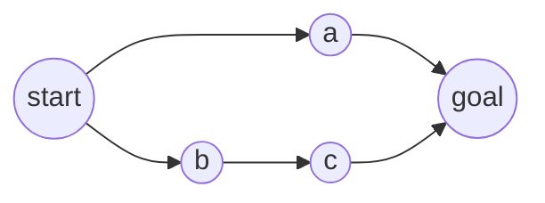

# Planning with Breadth-First Search

## Learning outcomes

After this lesson you can:

- Formulate planning as graph search
- Find a shortest action sequence with breadth-first search
- Reconstruct plans from parent pointers

## Intuition
Before acting, an agent can *imagine* sequences of actions and pick one that reaches the goal. When
every action costs the same, exploring plans in order of length (breadth-first) finds a shortest one.

## Precise explanation (AIMA, ch. 3)
* `successors(state)` → list of `(action, next_state)`.
* BFS: FIFO queue (`collections.deque`) starting at `start`; mark states visited when **enqueued**;
  record `parent[next] = (state, action)`; stop when a dequeued state passes `goal_test`.
* Reconstruct by following parents back to the start and reversing.
* Deterministic order: expand successors in the order given.
* Unreachable goal → `None`. Complexity O(|V| + |E|).

## Worked example
Rooms: hall → kitchen, hall → study, study → garden, kitchen → garden. Shortest plan from hall to
garden has 2 actions; with successors listed kitchen first, BFS returns ["go kitchen", "go garden"].

## Common mistakes
* Marking visited on dequeue (duplicates and extra work).
* DFS instead of BFS (not shortest).
* Forgetting the start can already be a goal (empty plan).

## Why this matters
Classical planning remains useful inside LLM agents (deterministic sub-problems, verifying plans);
A* (AG-12) adds costs and heuristics.

## References

- [Artificial Intelligence: A Modern Approach (4th ed.)](https://aima.cs.berkeley.edu/) — Stuart Russell, Peter Norvig (`S038`)
