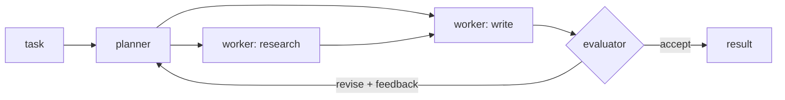

# Orchestrator–Workers with an Evaluator

## Learning outcomes

After this lesson you can:

- Decompose a task into typed subtasks with a planner
- Route subtasks to specialised workers in dependency order
- Use an evaluator to request revisions within a round limit

## Intuition
A lead agent breaks a job into pieces, hands each piece to a specialist, and assembles the results. A
reviewer then checks the result and may send it back with comments. Anthropic's "Building effective
agents" describes these patterns as **orchestrator–workers** and **evaluator–optimizer**.

## Precise explanation
Components (here all deterministic Python functions, stand-ins for LLM calls):
* `planner(task, feedback)` → list of subtasks `{"id", "type", "input", "deps"}` (feedback is `None`
  in round 1).
* `workers[type](input, dep_outputs)` → output (dep_outputs: dict id → output of dependencies).
* `evaluator(task, outputs)` → `(accepted: bool, feedback: str)`.
Round loop (up to `max_rounds`): plan; run subtasks in topological order (AG-13 rule: smallest id among
ready ones); collect outputs; evaluate; stop if accepted, else re-plan with the feedback. Unknown worker
types or failing workers are recorded as errors in the log and make the round fail without calling the
evaluator.

## Worked example
Planner splits "brief on X" into research → write; evaluator rejects drafts shorter than 5 words with
feedback "too short"; planner then asks the writer for a long version → accepted in round 2.

## Common mistakes
* Running dependent subtasks before their inputs exist.
* Infinite revise loops (always cap rounds).
* Letting one failing worker crash the whole pipeline.

## Why this matters
Most production "multi-agent" systems are carefully structured workflows like this rather than free-form
agent chatter.

## References

- [Building effective AI agents](https://www.anthropic.com/research/building-effective-agents) — Anthropic (`S037`)
