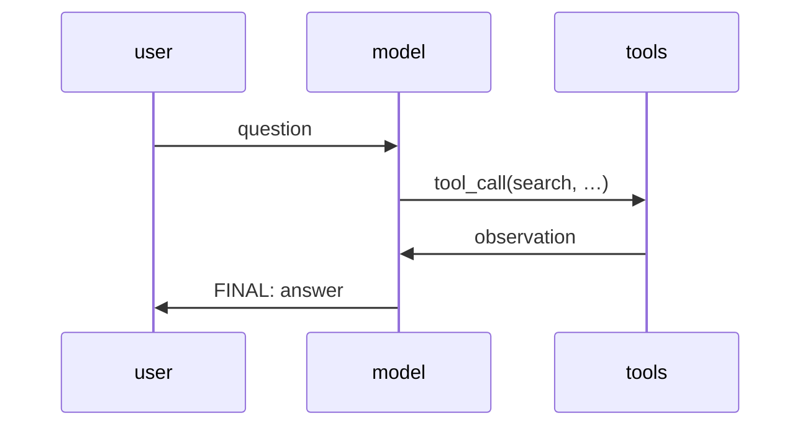

# The ReAct Loop

## Learning outcomes

After this lesson you can:

- Interleave reasoning, tool actions and observations
- Feed tool results and errors back to the model
- Stop on a final answer or step limit

## Intuition
ReAct (Yao et al., 2022) lets a language model alternate between *thinking*, *acting* (calling a tool)
and *observing* the result, so it can look things up instead of guessing. The agent code is just a
loop that shuttles messages between the model and the tools.

## Precise explanation
Transcript as a list of messages `{"role": ..., "content": ...}`:
1. Start with `{"role": "user", "content": question}`.
2. Repeat up to `max_steps`:
   * `text = model(transcript)` (our scripted model is a Python function); append
     `{"role": "assistant", "content": text}`.
   * Parse it (AG-02). Final → return the answer. Tool call → dispatch (AG-01) and append
     `{"role": "tool", "content": json.dumps(result)}`. Invalid → append
     `{"role": "tool", "content": json.dumps({"ok": False, "error": ...})}` so the model can fix itself.
3. Out of steps → status `"step_limit"`.

## Worked example
Scripted model: first reply calls `add(2, 3)`; after seeing `{"ok": true, "result": 5}` it replies
`FINAL: 5`. The loop returns answer "5" after 2 model calls.

## Common mistakes
* Not appending observations (the model never sees results).
* Crashing on invalid output instead of reporting the error.
* No step limit.

## Why this matters
This loop — model, tools, observations — is the core of tool-using LLM agents.

## References

- [ReAct: Synergizing Reasoning and Acting in Language Models](https://arxiv.org/abs/2210.03629) — Shunyu Yao et al. (`S036`)
- [Building effective AI agents](https://www.anthropic.com/research/building-effective-agents) — Anthropic (`S037`)
