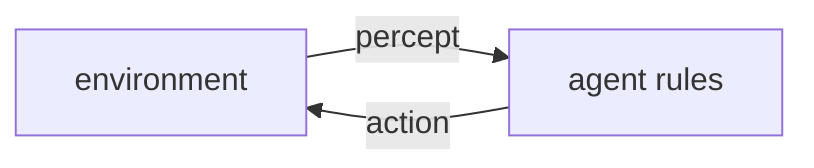

# Agents and Environments

## Learning outcomes

After this lesson you can:

- Model an environment with percepts, actions and a performance measure
- Implement a simple reflex agent
- Run and log an agent–environment loop

## Intuition
Strip away the LLM and an agent is still: sense the world, choose an action, change the world. Russell
and Norvig's classic two-square vacuum world makes this concrete.

## Precise explanation (AIMA, ch. 2)
* **Environment:** squares A and B, each Clean or Dirty; the agent is in one square.
* **Percept:** `(location, status)` — the agent only sees its own square (partial observability).
* **Actions:** `"Suck"`, `"Left"`, `"Right"`.
* **Simple reflex agent:** maps the current percept to an action with condition–action rules:
  if Dirty → Suck; elif at A → Right; else → Left.
* **Performance measure** (our choice): +1 for each clean square after each step, −1 per movement.
The loop: percept = env.percept(); action = agent(percept); env.execute(action); record.

## Worked example
Start at A, both dirty: Suck (A clean, score +1), Right (−1 +1), Suck (+2), Left (−1 +2) …

## Common mistakes
* Letting the agent read the whole environment state (breaks the percept abstraction).
* Mixing up the agent function (decision) with the environment (dynamics).
* Scoring movement and cleanliness inconsistently.

## Why this matters
LLM agents are exactly this loop with a learned policy and tools as actions; AG-05 adds goals and budgets.

## References

- [Artificial Intelligence: A Modern Approach (4th ed.)](https://aima.cs.berkeley.edu/) — Stuart Russell, Peter Norvig (`S038`)
