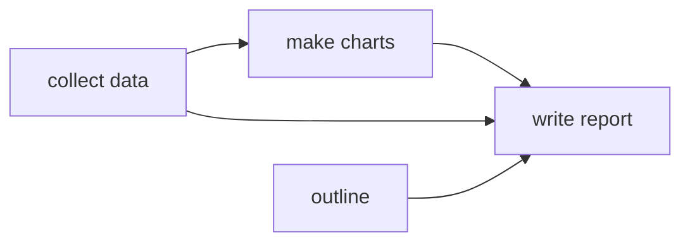

# Plans as Dependency Graphs

## Learning outcomes

After this lesson you can:

- Represent a plan as a dependency graph
- Topologically sort tasks with Kahn's algorithm
- Detect cycles and group tasks into parallel stages

## Intuition
"Write the report" needs "collect data" and "make charts" first; charts need data. Agents (and
orchestrators, AG-17) must run sub-tasks in an order that respects dependencies — and can run
independent ones in parallel.

## Precise explanation
`deps` maps each task to the set of tasks it depends on (all tasks appear as keys).
**Kahn's algorithm:**
1. In-degree = number of unmet dependencies per task.
2. Start with all tasks of in-degree 0 (sorted, for determinism — use a heap).
3. Pop the smallest ready task, append it, decrement in-degrees of tasks that depend on it; push newly
   ready ones.
4. If fewer tasks were output than exist, there is a **cycle** → error.
**Stages:** repeatedly take *all* currently ready tasks as one stage (sorted), remove them, repeat —
each stage could run in parallel.

## Worked example
deps = {data: {}, outline: {}, charts: {data}, report: {data, charts, outline}} →
order [data, charts, outline, report]; stages [[data, outline], [charts], [report]].

## Common mistakes
* Reversing edge direction (dependents vs dependencies).
* Infinite loops on cycles.
* Non-deterministic order from set iteration.

## Why this matters
Build systems, data pipelines and multi-step agent plans all schedule work this way.

## References

- [Artificial Intelligence: A Modern Approach (4th ed.)](https://aima.cs.berkeley.edu/) — Stuart Russell, Peter Norvig (`S038`)
- [Building effective AI agents](https://www.anthropic.com/research/building-effective-agents) — Anthropic (`S037`)
