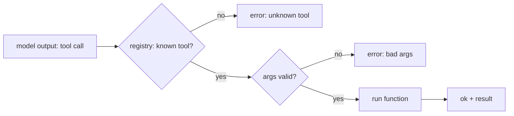

# Tools: How Agents Act

## Learning outcomes

After this lesson you can:

- Register tools with a name, function and argument schema
- Validate tool-call arguments before execution
- Return structured success/error results instead of crashing

## Intuition
A language model can only produce text. To *do* things — search, calculate, read files — it emits a
request like `{"tool": "add", "args": {"a": 2, "b": 3}}`, and ordinary code runs the matching function.
The registry is the switchboard between the model and the world.

## Precise explanation
* **Register:** name → (function, schema, description). The schema lists required argument names and
  their Python types, e.g. `{"a": int, "b": int}`.
* **Dispatch:** look up the tool; check arguments (missing, unexpected, wrong type); call the function;
  wrap the outcome as `{"ok": True, "result": ...}` or `{"ok": False, "error": "..."}`.
* Errors become **data returned to the model**, not exceptions that kill the agent: the model can read
  the error and retry (AG-15).
* Clear tool names and descriptions matter: Anthropic's "Building effective agents" article
  recommends investing in well-documented, hard-to-misuse tool interfaces.

## Worked example
dispatch({"tool": "add", "args": {"a": 2, "b": "3"}}) → `{"ok": False, "error": "argument 'b' must be int"}`.

## Common mistakes
* Calling `fn(**args)` without validation (crashes or worse, silent misuse).
* Raising exceptions out of dispatch.
* Accepting `True` for an `int` parameter (bool is a subclass of int; see PY-19).

## Why this matters
Every agent framework has this layer; validation here is the first line of defence for safety
(AG-19).

## References

- [Building effective AI agents](https://www.anthropic.com/research/building-effective-agents) — Anthropic (`S037`)
