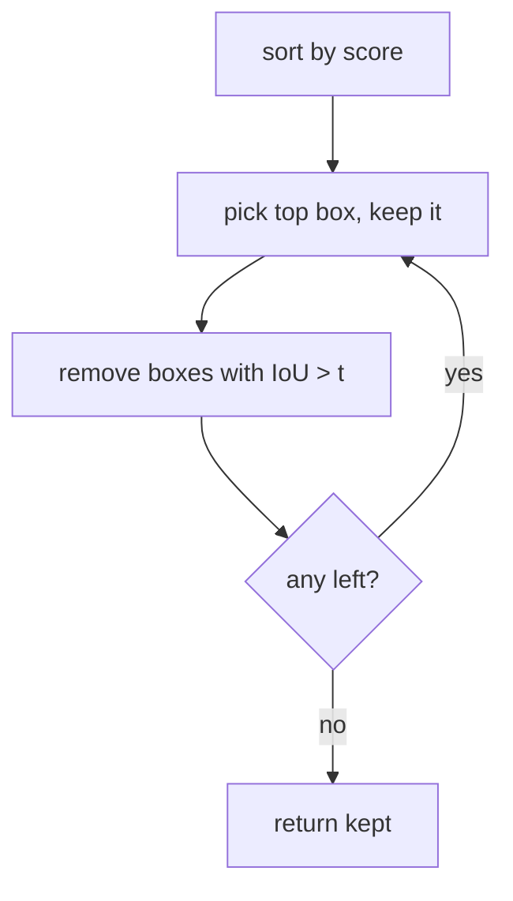

# Non-Maximum Suppression (NMS)

## Learning outcomes

After this lesson you can:

- Implement greedy NMS
- Apply score and IoU thresholds
- Return kept indices in score order

## Intuition
Detectors fire many overlapping boxes around the same object. NMS keeps the most confident box and
removes others that overlap it too much, then repeats — one box per object.

## Precise explanation
Greedy NMS:
1. Discard boxes with score < `score_threshold`.
2. Sort remaining boxes by score descending (ties → lower index first).
3. While candidates remain: take the first (highest score), **keep** it, and remove every remaining
   candidate whose IoU with it is **> `iou_threshold`**.
4. Return kept indices (into the original arrays) in the order they were kept.
Standard NMS is class-agnostic within one class; for multiple classes run it per class.

## Worked example
Boxes A [0,0,2,2] s 0.9, B [0.1,0,2.1,2] s 0.8 (IoU ≈ 0.90 with A), C [5,5,6,6] s 0.7 →
keep A, drop B, keep C → [0, 2].

## Common mistakes
* Comparing every box only with the global best (must compare with each kept box as you go).
* Using ≥ vs > inconsistently.
* Returning sorted indices instead of keep order.

## Why this matters
Every classic detector (YOLO, SSD, Faster R-CNN) applies NMS at inference.

## References

- [Dive into Deep Learning](https://d2l.ai/) — Aston Zhang, Zachary C. Lipton, Mu Li, Alexander J. Smola (`S013`)
