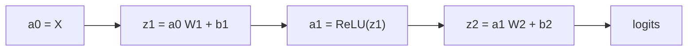

# Multilayer Perceptron: Forward Pass

## Learning outcomes

After this lesson you can:

- Chain dense layers and activations
- Cache intermediate values for backprop
- Produce class predictions with softmax

## Intuition
An MLP passes data through layers like an assembly line: each station applies a dense layer and
then an activation, handing the result to the next station. The last station outputs raw scores
(logits).

## Precise explanation
With parameters `[(W1, b1), …, (WL, bL)]`:
$$a_0 = X,\quad z_l = a_{l-1}W_l + b_l,\quad a_l = \text{ReLU}(z_l)\ (l < L),\quad \text{logits} = z_L.$$
No activation on the output layer — softmax/cross-entropy (DL-02/03) handle it.
**Cache:** backpropagation needs every $a_{l-1}$ and $z_l$, so store them during the forward pass.
Predicted class = `argmax(logits, axis=1)` (softmax is monotone, so it isn't needed for argmax).

## Worked example
X = [[1, −1]], W1 = I, b1 = 0 → z1 = [1, −1] → a1 = [1, 0]; W2 = [[2], [3]], b2 = [0.5] →
logits = [[2.5]].

## Common mistakes
* Applying ReLU to the output logits.
* Losing the cache (overwriting variables) and being unable to backprop.
* Shape drift — check `(n, d_l)` after each layer.

## Why this matters
This is the inference path of every feed-forward network; DL-19 adds the backward pass.

## References

- [Dive into Deep Learning](https://d2l.ai/) — Aston Zhang, Zachary C. Lipton, Mu Li, Alexander J. Smola (`S013`)
- [Neural Networks and Deep Learning](http://neuralnetworksanddeeplearning.com/) — free online book (author not stated on landing page) (`S014`)
