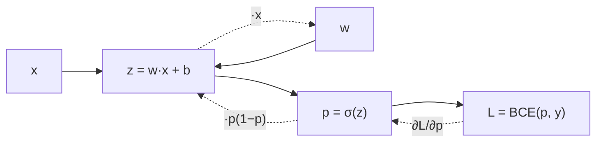

# Backpropagation in One Neuron

## Learning outcomes

After this lesson you can:

- Apply the chain rule through a computational graph
- Compute gradients of a sigmoid neuron with BCE
- Confirm the simplification dL/dz = p − y

## Intuition
Backpropagation is the chain rule applied systematically: to know how the loss changes with a
weight, multiply how the loss changes with the output, how the output changes with the
pre-activation, and how the pre-activation changes with the weight.

## Precise explanation
Graph for one example: $z = w\cdot x + b$ → $p = \sigma(z)$ → $L = -[y\log p + (1-y)\log(1-p)]$.
Local derivatives:
* $\partial L/\partial p = -\frac{y}{p} + \frac{1-y}{1-p}$
* $\partial p/\partial z = p(1-p)$
* $\partial z/\partial w = x$, $\partial z/\partial b = 1$
Chain: $\frac{\partial L}{\partial z} = \frac{\partial L}{\partial p}\frac{\partial p}{\partial z} = p - y$,
so $\nabla_w L = (p-y)x$ and $\partial L/\partial b = p-y$.

## Worked example
x = [1, 2], w = [0.5, −0.25], b = 0, y = 1: z = 0, p = 0.5, L = log 2 = 0.693;
∂L/∂p = −2, ∂p/∂z = 0.25, ∂L/∂z = −0.5; ∇w = [−0.5, −1], ∂b = −0.5.

## Common mistakes
* Multiplying by $\sigma'(x)$ instead of $\sigma'(z)$.
* Sign errors (gradient points uphill).
* Not reusing forward values (p) in the backward pass.

## Why this matters
Every deep-learning framework does exactly this, layer by layer (DL-19).

## References

- [CS231n: Backpropagation notes](https://cs231n.github.io/optimization-2/) — Stanford University CS231n (`S016`)
- [Neural Networks and Deep Learning](http://neuralnetworksanddeeplearning.com/) — free online book (author not stated on landing page) (`S014`)
