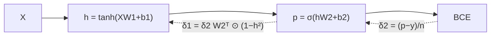

# Learning XOR with Backpropagation

## Learning outcomes

After this lesson you can:

- Implement full backpropagation for a 2-layer network
- Train with gradient descent until XOR is solved
- Explain why a linear model cannot solve XOR

## Intuition
XOR outputs 1 when exactly one input is 1. No straight line separates {(0,1), (1,0)} from
{(0,0), (1,1)}, so logistic regression fails. A hidden layer can bend the space so a line
works — and backpropagation finds the weights automatically.

## Precise explanation
Network 2 → H → 1: $h = \tanh(XW_1 + b_1)$, $p = \sigma(hW_2 + b_2)$, loss = mean BCE.
Backward pass (n examples, from DL-03/06):
* $\delta_2 = (p - y)/n$  (shape `(n, 1)`)
* $\nabla W_2 = h^\top \delta_2$, $\nabla b_2 = \sum \delta_2$
* $\delta_1 = (\delta_2 W_2^\top) \odot (1 - h^2)$
* $\nabla W_1 = X^\top \delta_1$, $\nabla b_1 = \sum \delta_1$
Then $\theta \leftarrow \theta - \eta\nabla\theta$. Random (not zero) initial weights break
symmetry between hidden units.

## Worked example
After training (seed 0, H = 8, lr = 1, 3000 epochs) the reference network reaches a loss below
0.001 and outputs probabilities close to [0, 1, 1, 0] for inputs (0,0), (0,1), (1,0), (1,1).

**Local minima are real.** In this build, H = 4 with seed 0 gets stuck at a loss of about 0.35
(seeds 1–7 succeed); with H = 8 all of seeds 0–7 succeed. Wider layers and different seeds are the
usual remedies.

## Common mistakes
* Forgetting the $(1-h^2)$ factor.
* Using $W_2$ after updating it to compute $\delta_1$ (compute all gradients first).
* Zero initialisation (hidden units stay identical).

## Why this matters
This is a complete deep-learning training loop; frameworks automate the backward pass, but the
structure — forward, loss, backward, update — is identical.

## References

- [Neural Networks and Deep Learning](http://neuralnetworksanddeeplearning.com/) — free online book (author not stated on landing page) (`S014`)
- [CS231n: Backpropagation notes](https://cs231n.github.io/optimization-2/) — Stanford University CS231n (`S016`)
- [Dive into Deep Learning](https://d2l.ai/) — Aston Zhang, Zachary C. Lipton, Mu Li, Alexander J. Smola (`S013`)
