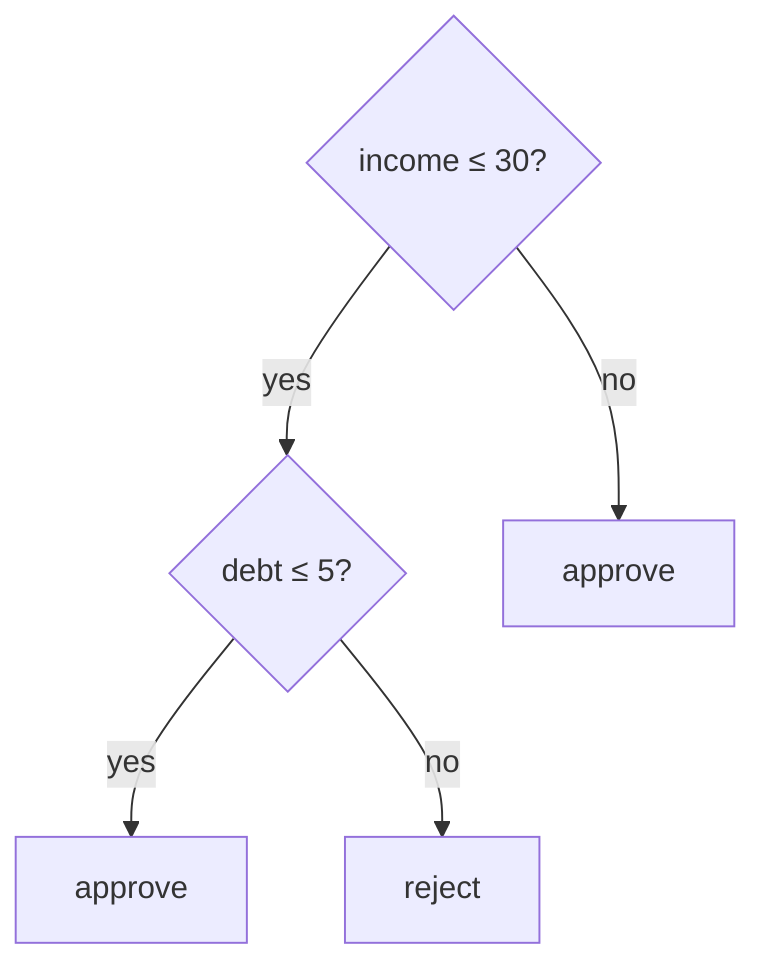

# Decision Paths: Explanations for Free

## Learning outcomes

After this lesson you can:

- Traverse a tree model represented as nested dicts
- Record each condition tested
- Generate a rule-style explanation

## Intuition
A decision tree is interpretable by construction: the explanation of a prediction is the list of
questions asked on the way to the leaf. "Income ≤ 30k → yes; debt > 5k → yes → reject."

## Precise explanation
Represent a tree as nested dicts:
* internal node: `{"feature": j, "threshold": t, "left": node, "right": node}` — go **left** if
  $x_j \le t$ (as in ML-21), else right;
* leaf: `{"value": v}`.
The path is the sequence of (feature, operator, threshold) conditions satisfied. This is an
**intrinsic** explanation (the model *is* the explanation), unlike post-hoc methods (XA-06+). Deep
trees produce long paths that are no longer easy to read — interpretability depends on size.

## Worked example
x = {income 25, debt 8}: income ≤ 30 ✓ → debt ≤ 5 ✗ → "reject"; path
["income <= 30", "debt > 5"].

## Common mistakes
* Inconsistent `<=` vs `<` with the training convention.
* Losing the right-branch condition (it should read "> t").
* Mutating the tree while traversing.

## Why this matters
Rule-style explanations are what many regulated domains (credit, healthcare) expect; trees are also
used as global surrogates (XA-10).

## References

- [Interpretable Machine Learning (3rd edition)](https://christophm.github.io/interpretable-ml-book/) — Christoph Molnar (`S024`)
