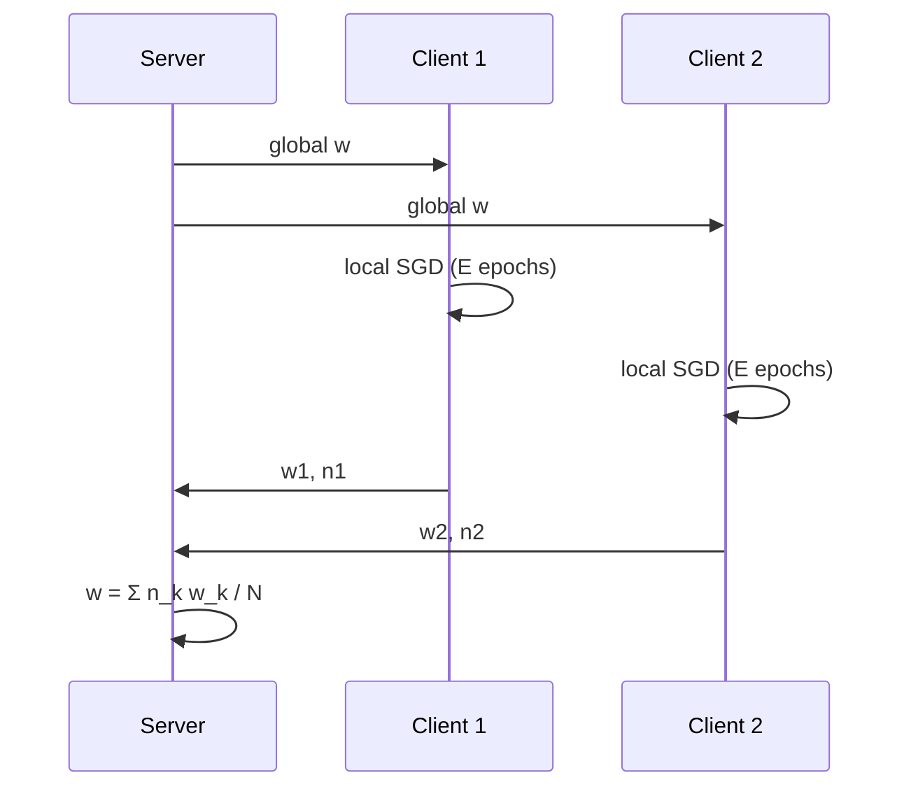

# One Round of FedAvg

## Learning outcomes

After this lesson you can:

- Broadcast the global model, train locally, aggregate
- Use distinct reproducible seeds per client
- Relate one-epoch full-batch FedAvg to centralised gradient descent

## Intuition
A round is: the server sends the current model to the selected clients; each trains locally; they
send models back; the server averages them weighted by data size.

## Precise explanation

Client k uses seed `seed + k` so runs are reproducible but clients shuffle differently.
**Sanity check:** with E = 1 and full-batch local training (B = n_k), one FedAvg round equals one
step of centralised gradient descent on the pooled data, because the size-weighted average of local
gradients is the global gradient.

## Worked example
Two clients with identical data → identical local models → the average equals either one.

## Common mistakes
* Letting client k start from client k−1's model (must all start from the same global w).
* Using the same seed for every client.
* Unweighted averaging.

## Why this matters
This is FedAvg; FL-10 loops it with client sampling.

## References

- [Communication-Efficient Learning of Deep Networks from Decentralized Data](https://arxiv.org/abs/1602.05629) — H. Brendan McMahan, Eider Moore, Daniel Ramage, Seth Hampson, Blaise Agüera y Arcas (`S028`)
