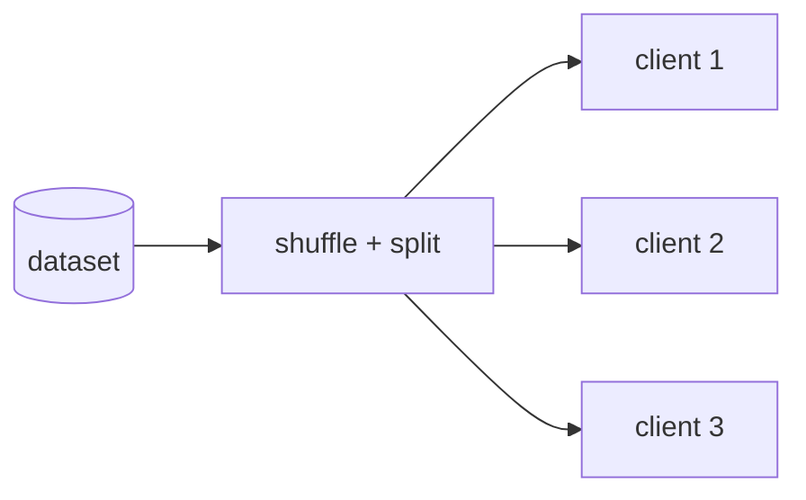

# Simulating Clients: IID Partitions

## Learning outcomes

After this lesson you can:

- Simulate clients by partitioning a dataset
- Produce disjoint, near-equal IID shards
- Report client dataset sizes

## Intuition
In federated learning (FL), data lives on many devices (phones, hospitals). To study FL algorithms
on one machine we split a dataset into "client" shards. The easiest split is **IID**: every client
gets a random sample, so all clients look statistically alike.

## Precise explanation
* Shuffle indices with a seeded generator: `rng.permutation(n)`.
* Split into `n_clients` nearly equal parts with `np.array_split` (sizes differ by at most 1).
* Shards must be **disjoint** and **cover** all indices.
* Real federated data is rarely IID (FL-04) and client sizes are often very unequal — which is why
  FedAvg weights clients by size (FL-02).
McMahan et al. (2016) evaluate both IID and pathological non-IID partitions.

## Worked example
n = 10, 3 clients → sizes [4, 3, 3].

## Common mistakes
* Overlapping shards (sampling with replacement).
* Forgetting the seed → irreproducible experiments.
* Assuming equal client sizes later in the pipeline.

## Why this matters
Every FL experiment starts with a partition; its realism decides whether conclusions transfer to
real deployments.

## References

- [Communication-Efficient Learning of Deep Networks from Decentralized Data](https://arxiv.org/abs/1602.05629) — H. Brendan McMahan, Eider Moore, Daniel Ramage, Seth Hampson, Blaise Agüera y Arcas (`S028`)
- [Advances and Open Problems in Federated Learning](https://arxiv.org/abs/1912.04977) — Peter Kairouz, H. Brendan McMahan et al. (`S032`)
