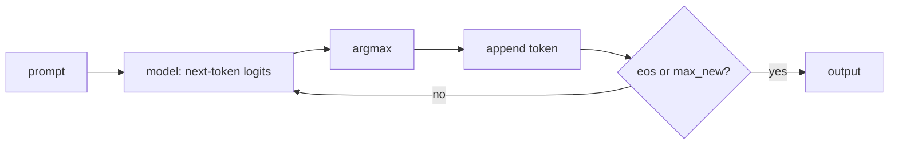

# Autoregressive Generation: Greedy Decoding

## Learning outcomes

After this lesson you can:

- Run an autoregressive generation loop
- Stop on an end-of-sequence token or a length limit
- Recognise repetition loops in greedy output

## Intuition
A language model writes one token at a time: look at everything so far, pick the next token,
append it, repeat. **Greedy** decoding always picks the single most likely token.

## Precise explanation
```text
tokens = prompt
repeat up to max_new times:
    logits = model(tokens)          # scores for every vocabulary entry
    t = vocab[argmax(logits)]       # ties → lowest index
    append t
    if t == eos: stop
```
Greedy decoding is deterministic and fast but can loop ("the the the …") or miss better overall
sequences that start with a less likely token — beam search (LM-14) and sampling (LM-13) address
this.



## Worked example
A toy model where "i"→"like", "like"→"tea", "tea"→"</s>": prompt ["i"] → ["i", "like", "tea", "</s>"].

## Common mistakes
* Forgetting to feed the *updated* sequence back into the model.
* Not stopping at EOS, or stopping before appending it.
* Infinite loops without `max_new`.

## Why this matters
Every chatbot reply is produced by such a loop; understanding it explains latency (one model call
per token) and the KV cache optimisation (LM-15).

## References

- [Dive into Deep Learning](https://d2l.ai/) — Aston Zhang, Zachary C. Lipton, Mu Li, Alexander J. Smola (`S013`)
- [LLM Course](https://huggingface.co/learn/llm-course/chapter1/1) — Hugging Face (`S022`)
