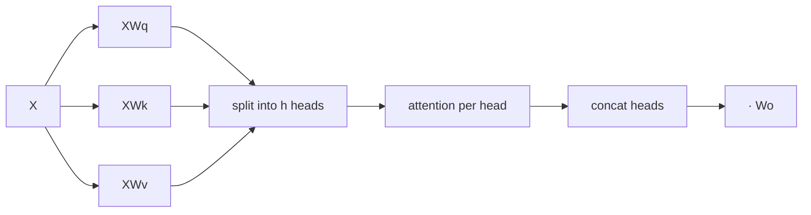

# Multi-Head Self-Attention

## Learning outcomes

After this lesson you can:

- Project inputs to queries, keys and values
- Split into heads, attend in parallel and concatenate
- Apply the output projection and optional causal mask

## Intuition
One attention pattern can focus on one kind of relationship. Multiple heads let the model attend to
different things at once — syntax in one head, coreference in another — then combine the results.

## Precise explanation
For input $X$ `(T, d_model)` and $h$ heads with $d_h = d_\text{model}/h$:
1. $Q = XW_q,\ K = XW_k,\ V = XW_v$ (each `(T, d_model)`).
2. **Split heads:** reshape `(T, d_model)` → `(T, h, d_h)` → transpose to `(h, T, d_h)`.
3. Per head: $\text{softmax}(Q_iK_i^\top/\sqrt{d_h} + \text{mask})V_i$.
4. **Merge heads:** `(h, T, d_h)` → `(T, h, d_h)` → `(T, d_model)` (concatenation).
5. Output projection: $\text{concat}\cdot W_o$.
With h = 1 this reduces to single-head attention followed by $W_o$.

## Worked example
d_model = 4, h = 2: head 0 uses feature columns 0–1 of Q/K/V, head 1 columns 2–3.

## Common mistakes
* Reshaping `(T, d)` to `(h, T, d_h)` directly (mixes positions and features) — reshape then transpose.
* Scaling by √d_model instead of √d_h.
* Forgetting the output projection.

## Why this matters
This block (plus a feed-forward layer and residual connections) is the transformer layer stacked
dozens of times in every LLM.

## References

- [Attention Is All You Need](https://arxiv.org/abs/1706.03762) — Ashish Vaswani et al. (`S019`)
- [Dive into Deep Learning](https://d2l.ai/) — Aston Zhang, Zachary C. Lipton, Mu Li, Alexander J. Smola (`S013`)
