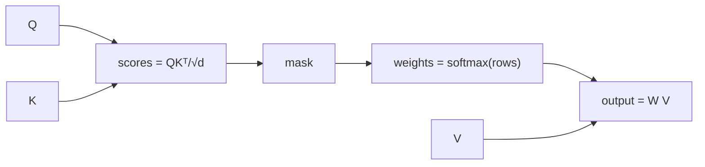

# Scaled Dot-Product Attention

## Learning outcomes

After this lesson you can:

- Compute attention scores QKᵀ/√d
- Apply softmax row-wise to get attention weights
- Mix value vectors with the weights; support masks

## Intuition
Each token asks a question (query), every token advertises what it contains (key) and what it
would contribute (value). A token's output is a weighted average of all values, weighted by how
well its query matches each key.

## Precise explanation (Vaswani et al., 2017)
For queries $Q$ `(T_q, d_k)`, keys $K$ `(T_k, d_k)`, values $V$ `(T_k, d_v)`:
$$\text{Attention}(Q,K,V) = \text{softmax}\!\left(\frac{QK^\top}{\sqrt{d_k}}\right)V.$$
* Scores `(T_q, T_k)`; dividing by $\sqrt{d_k}$ keeps their scale independent of dimension,
  avoiding an overly peaked softmax.
* Softmax is taken over the **key** axis (each row sums to 1).
* A boolean `mask` (True = allowed) sets disallowed scores to −∞ before softmax (LM-08).

## Worked example
Q = [[1, 0]], K = [[1, 0], [0, 1]], V = [[1, 2], [3, 4]], d = 2: scores [0.707, 0] →
weights [0.670, 0.330] → output [1.66, 2.66].

## Common mistakes
* Softmax over the wrong axis.
* Forgetting the √d scaling.
* Masking after softmax (weights no longer sum to 1).

## Why this matters
Attention is the core operation of transformers and LLMs.

## References

- [Attention Is All You Need](https://arxiv.org/abs/1706.03762) — Ashish Vaswani et al. (`S019`)
- [Dive into Deep Learning](https://d2l.ai/) — Aston Zhang, Zachary C. Lipton, Mu Li, Alexander J. Smola (`S013`)
