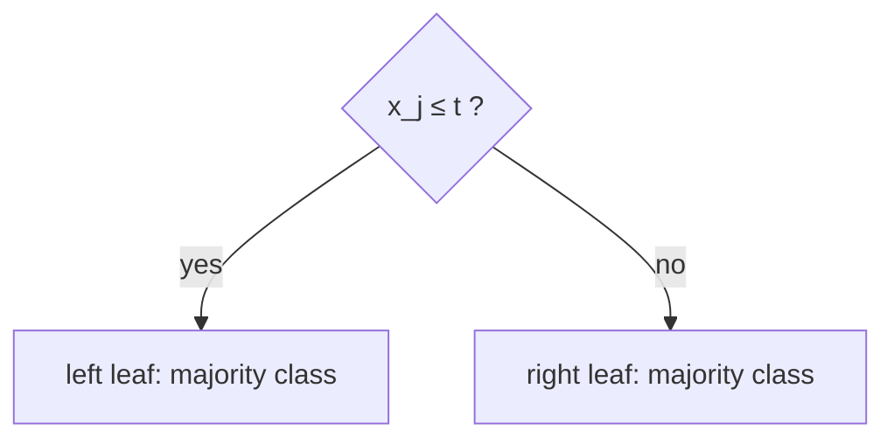

# Decision Stumps and Gini Impurity

## Learning outcomes

After this lesson you can:

- Compute Gini impurity
- Search thresholds at midpoints between sorted unique values
- Choose the split with the lowest weighted impurity

## Intuition
A decision tree asks yes/no questions ("is age < 30?"). A **stump** asks one. The best question
splits the data into groups that are as *pure* (single-class) as possible.

## Precise explanation
**Gini impurity** of labels with class proportions $p_c$: $G = 1 - \sum_c p_c^2$. Pure → 0;
50/50 binary → 0.5.
For a split into left (L) and right (R):
$$G_\text{split} = \frac{n_L}{n} G(L) + \frac{n_R}{n} G(R).$$
**Candidate thresholds:** for each feature, midpoints between consecutive *distinct* sorted
values. Rule: go left if $x_j \le t$.
**Search:** try every feature and threshold; keep the lowest $G_\text{split}$. Ties → lowest
feature index, then lowest threshold. Leaves predict their majority class (ties → smaller label).

## Worked example
x = [1, 2, 3, 4], y = [0, 0, 1, 1]: thresholds 1.5, 2.5, 3.5. At 2.5 both sides are pure →
G = 0. Best split: feature 0, t = 2.5, left 0, right 1.

## Common mistakes
* Using raw values as thresholds (≤ on the largest value sends everything left).
* Forgetting to weight child impurities by size.
* Considering thresholds between duplicate values (no-op splits).

## Why this matters
Stumps are the weak learners in boosting; trees and forests are stacked stumps, and their
decision paths are inherently interpretable (XA-03).

## Library implementation

A depth-1 `sklearn.tree.DecisionTreeClassifier(max_depth=1, criterion="gini")` is a decision
stump: it searches the same midpoint thresholds and minimises the same weighted Gini impurity. Its
`tree_` attribute exposes the chosen `feature[0]` and `threshold[0]`.

## References

- [User Guide (scikit-learn 1.9.1)](https://scikit-learn.org/stable/user_guide.html) — scikit-learn developers (`S012`)
- [Interpretable Machine Learning (3rd edition)](https://christophm.github.io/interpretable-ml-book/) — Christoph Molnar (`S024`)
