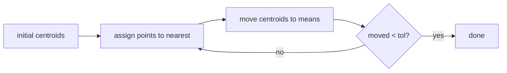

# k-Means

## Learning outcomes

After this lesson you can:

- Alternate assignment and update steps
- Handle empty clusters and convergence
- Compute inertia (within-cluster sum of squares)

## Intuition
Place k "centres", give each point to its nearest centre, move each centre to the average of its
points, repeat. Groups of similar points emerge without any labels — **unsupervised** learning.

## Precise explanation
Lloyd's algorithm minimises **inertia** $J = \sum_i \lVert x_i - \mu_{c(i)}\rVert^2$:
1. **Assign:** $c(i) = \arg\min_j \lVert x_i - \mu_j\rVert^2$ (lowest index on ties).
2. **Update:** $\mu_j$ = mean of points assigned to $j$. If a cluster is empty, keep its old
   centroid (one common policy).
3. Stop when centroids move less than `tol` (max squared shift) or after `max_iter` iterations.
Each step never increases $J$, so the algorithm converges — but only to a *local* optimum that
depends on initialisation (k-means++ or several restarts help). Passing initial centroids
explicitly makes runs deterministic.

## Worked example
X = [0, 1, 10, 11] (1-D), init [0, 1]: assign → {0}, {1, 10, 11}; update → 0, 7.33; assign →
{0, 1}, {10, 11}; update → 0.5, 10.5; stable. Inertia = 4 × 0.25 = 1.0.

## Common mistakes
* Recomputing distances with the *new* centroids before assigning (mixing steps).
* Dividing by zero for empty clusters.
* Comparing labels across runs: cluster ids are arbitrary.

## Why this matters
Clustering segments users, compresses colours (vector quantisation), initialises mixture models,
and illustrates the alternating-optimisation pattern used across ML.

## Library implementation

`sklearn.cluster.KMeans(n_clusters=k, init=initial_centroids, n_init=1, algorithm="lloyd")` runs
the same Lloyd iterations from the same starting centroids; by default it instead chooses starts
with k-means++ and keeps the best of several runs. The comparison runs when scikit-learn is
installed.

## References

- [User Guide (scikit-learn 1.9.1)](https://scikit-learn.org/stable/user_guide.html) — scikit-learn developers (`S012`)
