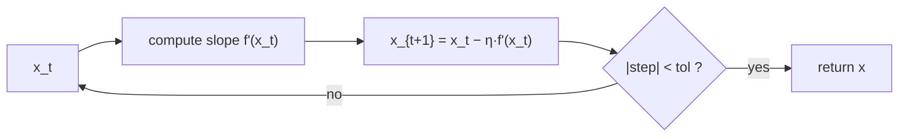

# Gradient Descent

## Learning outcomes

After this lesson you can:

- Implement the gradient-descent update
- Use a convergence tolerance and step cap
- Explain divergence when the learning rate is too large

## Intuition
Standing on a hillside in fog, you can feel which way is downhill under your feet. Take a step
that way, feel again, repeat. That is gradient descent: follow the negative slope to reach a
minimum.

## Precise explanation
To minimise $f(x)$, start at $x_0$ and repeat
$$x_{t+1} = x_t - \eta\, f'(x_t),$$
where $\eta > 0$ is the **learning rate**. Stop when the step is tiny,
$|x_{t+1} - x_t| < \text{tol}$, or after a maximum number of steps.

For $f(x) = (x-3)^2$, $f'(x) = 2(x-3)$, so
$x_{t+1} - 3 = (1 - 2\eta)(x_t - 3)$. The error is multiplied by $1-2\eta$ each step:
* $0 < \eta < 1$: $|1-2\eta| < 1$ → converges;
* $\eta = 1$: oscillates forever between two points;
* $\eta > 1$: $|1-2\eta| > 1$ → **diverges**.

## Worked example
$f(x)=(x-3)^2$, $x_0 = 0$, $\eta = 0.25$: error multiplier $0.5$; iterates 0 → 1.5 → 2.25 →
2.625 → … → 3.

## Common mistakes
* Adding the gradient (`x + lr*g`) — that climbs uphill.
* Testing convergence on $f'(x)$ with a tolerance far smaller than the step can resolve.
* Looping forever without a step cap when the learning rate diverges.

## Why this matters
Every neural network, logistic regression (ML-11) and federated client update (FL-06) is trained
with a variant of this loop.

## References

- [Mathematics for Machine Learning](https://mml-book.github.io/) — Marc Peter Deisenroth, A. Aldo Faisal, Cheng Soon Ong (Cambridge University Press) (`S009`)
- [Dive into Deep Learning](https://d2l.ai/) — Aston Zhang, Zachary C. Lipton, Mu Li, Alexander J. Smola (`S013`)
