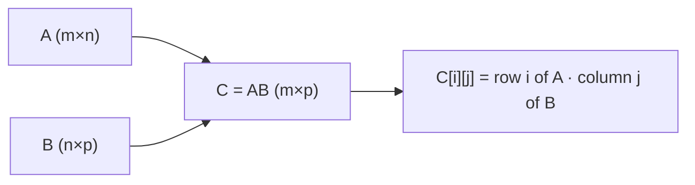

# Matrix Multiplication

## Learning outcomes

After this lesson you can:

- Multiply matrices with the row-by-column rule
- Check shape compatibility
- Recognise that AB ≠ BA in general

## Intuition
Each entry of a product $AB$ is a dot product: row $i$ of $A$ with column $j$ of $B$. A matrix
can be seen as a machine that transforms vectors; multiplying matrices composes the machines.

## Precise explanation
If $A$ is $m\times n$ and $B$ is $n\times p$, then $C = AB$ is $m\times p$ with
$$C_{ij} = \sum_{k=1}^{n} A_{ik} B_{kj}.$$
The inner dimensions must match ($n$). The shapes "cancel" like dominoes:
$(m\times \mathbf{n})(\mathbf{n}\times p) = m\times p$.

Properties: associative, $(AB)C = A(BC)$; distributive; **not** commutative — $AB$ and $BA$
usually differ, and one may not even be defined. The identity matrix $I$ satisfies $AI = IA = A$.

## Worked example
$$\begin{pmatrix}1&2\\3&4\end{pmatrix}\begin{pmatrix}5&6\\7&8\end{pmatrix}
=\begin{pmatrix}1\cdot5+2\cdot7 & 1\cdot6+2\cdot8\\ 3\cdot5+4\cdot7 & 3\cdot6+4\cdot8\end{pmatrix}
=\begin{pmatrix}19&22\\43&50\end{pmatrix}.$$
Reversing the order gives $\begin{pmatrix}23&34\\31&46\end{pmatrix}$ — different.

## Common mistakes
* Multiplying element-wise (the Hadamard product) instead.
* Checking `len(A) == len(B)` instead of columns of A vs rows of B.
* Pre-allocating with `[[0]*p]*m` (aliased rows — see PY-20).

## Why this matters
A dense neural-network layer is $XW$; a batch of predictions from linear regression is $Xw$;
attention is $\text{softmax}(QK^\top)V$. Shape reasoning is the most useful debugging skill in ML.

## References

- [Mathematics for Machine Learning](https://mml-book.github.io/) — Marc Peter Deisenroth, A. Aldo Faisal, Cheng Soon Ong (Cambridge University Press) (`S009`)
