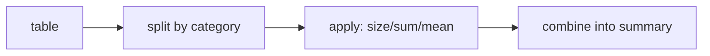

# Group-by: Split, Apply, Combine

## Learning outcomes

After this lesson you can:

- Apply split–apply–combine
- Use named aggregations
- Return a tidy, sorted summary table

## Intuition
"Average sale per category" means: **split** the rows by category, **apply** an aggregate to each
group, **combine** the results into a table — the pandas version of PY-18's manual grouping.

## Precise explanation
```python
df.groupby("category").agg(
    n=("value", "size"),
    total=("value", "sum"),
    mean=("value", "mean"),
).reset_index()
```
* **Named aggregation** `new_col=(source_col, func)` produces clear column names.
* `"size"` counts rows (including NaN values); `"count"` counts non-missing values.
* `groupby` sorts group keys by default (`sort=True`).
* `reset_index()` turns the group keys from the index back into a column.



## Worked example
category [a, b, a, b, a], value [1, 2, 3, NaN, 5] →
a: n 3, total 9, mean 3; b: n 2, count 1, total 2, mean 2.

## Common mistakes
* Confusing `size` and `count` with missing values.
* Forgetting `reset_index`, leaving keys in the index.
* Aggregating string columns with `mean`.

## Why this matters
Per-class accuracy, per-client data sizes in federated learning (FL-02) and per-user features
are group-bys.

## Library implementation

Before `groupby`, the same summary is a dictionary of lists (PY-18): append each
value to its category's list, then count, sum and average while skipping missing values. pandas
does the split–apply–combine in optimised code and keeps the result as a DataFrame. The test
computes the summary both ways.

## References

- [10 minutes to pandas (pandas 3.1.0 docs)](https://pandas.pydata.org/docs/user_guide/10min.html) — pandas via NumFOCUS (`S008`)
