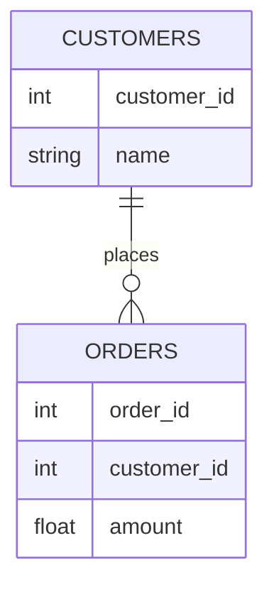

# Merging Tables

## Learning outcomes

After this lesson you can:

- Join tables on a key with merge
- Choose inner vs left joins
- Validate join cardinality

## Intuition
Orders list a `customer_id`; customer details live in another table. A **join** looks up each
order's customer and attaches their columns — like VLOOKUP, but for whole tables.

## Precise explanation
`pd.merge(left, right, on="customer_id", how=...)`:
* `how="inner"` keeps keys present in both tables.
* `how="left"` keeps every left row; missing matches get NaN.
* `how="outer"` keeps keys from either side.
* `validate="many_to_one"` raises `MergeError` if the right table has duplicate keys — which
  would silently duplicate left rows.
* `indicator=True` adds a `_merge` column ("both", "left_only", "right_only") for debugging.

## Worked example
orders (1, c1, 50), (2, c2, 20), (3, c9, 5); customers c1 Ann, c2 Bob →
left join: Ann, Bob, NaN→"unknown".

## Common mistakes
* Inner join silently dropping orders with unknown customers.
* Duplicate keys in a lookup table multiplying rows.
* Merging on columns with different dtypes (int vs string ids) → no matches.

## Why this matters
Features usually live in several tables (users, events, labels); correct joins prevent both lost
rows and duplicated labels.

## Library implementation

A left join is a dictionary lookup: build `{customer_id: name}` from the customers table, then
look up each order, using a default when the id is missing. `pd.merge` does this for whole tables,
can check the relationship (`validate="many_to_one"`), and supports inner, outer and right joins.
The test performs the join with a dict and compares.

## References

- [10 minutes to pandas (pandas 3.1.0 docs)](https://pandas.pydata.org/docs/user_guide/10min.html) — pandas via NumFOCUS (`S008`)
