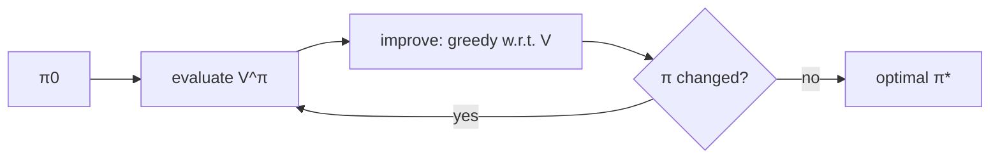

# Policy Iteration

## Learning outcomes

After this lesson you can:

- Alternate policy evaluation and greedy improvement
- Detect policy stability
- Verify agreement with value iteration

## Intuition
Start with any policy. Work out how good it is (evaluation), then switch every state to the action
that looks best given those values (improvement). Repeat until nothing changes — the policy is then
optimal. It usually needs surprisingly few rounds.

## Precise explanation (Sutton & Barto, §4.3)
1. Initialise deterministic policy π(s) = 0 for all s.
2. **Evaluate** π (RL-08) with the deterministic policy matrix.
3. **Improve:** π′(s) = argmax_a Q(s, a) from the evaluated V (ties → lowest action).
4. If π′ = π stop, else π ← π′ and repeat.
The policy improvement theorem guarantees each new policy is at least as good; with finitely many
deterministic policies the loop terminates. To avoid flip-flopping between equally good actions, the
lowest-index tie-break makes "unchanged" well defined.

## Worked example
Corridor with actions left/right: π₀ = all-left; evaluation gives negative values; improvement
switches the state next to the goal to right, then the others — stable after a few iterations.

## Common mistakes
* Comparing policies by values with floating-point noise instead of comparing actions.
* Forgetting to re-evaluate after improvement.
* Ties causing infinite loops.

## Why this matters
Policy iteration is the template for actor–critic methods: a critic evaluates, an actor improves.

## References

- [Reinforcement Learning: An Introduction (2nd edition)](http://incompleteideas.net/book/the-book-2nd.html) — Richard S. Sutton, Andrew G. Barto (MIT Press 2018) (`S033`)
- [Dive into Deep Learning — Reinforcement Learning chapter](https://d2l.ai/chapter_reinforcement-learning/index.html) — Pratik Chaudhari, Rasool Fakoor, Kavosh Asadi (D2L) (`S034`)
