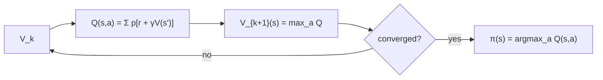

# Value Iteration

## Learning outcomes

After this lesson you can:

- Apply the Bellman optimality backup
- Extract a greedy policy from values
- Solve a small gridworld optimally

## Intuition
Instead of evaluating a fixed policy, assume you will always pick the best action. Repeatedly update
each state's value with the best one-step lookahead; the values converge to the optimal ones, and
acting greedily on them is optimal.

## Precise explanation (Sutton & Barto, §4.4)
$$Q(s, a) = \sum_{(p, s', r, d)} p\,[r + \gamma(1-d)V(s')],\qquad V_{k+1}(s) = \max_a Q_k(s, a).$$
Stop when the max change < θ; then the **greedy policy** $\pi(s) = \arg\max_a Q(s, a)$ (ties →
lowest action) is optimal (for small enough θ).

## Worked example
Corridor with "left" (stay, −1) and "right" (towards goal): optimal values match always-right
evaluation (RL-08); greedy policy = right everywhere.

## Common mistakes
* Taking the max over next states instead of over actions.
* Extracting the policy from stale values.
* Including terminal successors' values.

## Why this matters
Value iteration is the prototypical planning algorithm and the dynamic-programming ancestor of
Q-learning.

## References

- [Reinforcement Learning: An Introduction (2nd edition)](http://incompleteideas.net/book/the-book-2nd.html) — Richard S. Sutton, Andrew G. Barto (MIT Press 2018) (`S033`)
- [Dive into Deep Learning — Reinforcement Learning chapter](https://d2l.ai/chapter_reinforcement-learning/index.html) — Pratik Chaudhari, Rasool Fakoor, Kavosh Asadi (D2L) (`S034`)
