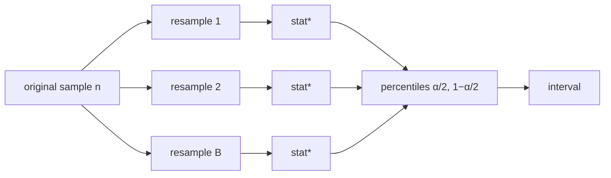

# The Bootstrap

## Learning outcomes

After this lesson you can:

- Resample with replacement
- Build a percentile bootstrap interval
- Explain what a confidence interval does and does not mean

## Intuition
We have one sample but want to know how much a statistic (e.g. the mean) would vary if we could
collect new samples. The bootstrap pretends the sample *is* the population and draws many
"new" samples from it, with replacement, recomputing the statistic each time. The spread of those
recomputed values estimates the statistic's uncertainty.

## Precise explanation
1. For $b = 1..B$: draw $n$ indices uniformly with replacement, form the resample, compute
   $\hat\theta^*_b$.
2. **Percentile interval** at level $1-\alpha$: the $\alpha/2$ and $1-\alpha/2$ percentiles of
   $\{\hat\theta^*_b\}$.

Index recipe used here (stable across Python versions): `int(rng.random() * n)`, drawn in order
for each position of each resample.

**Interpretation:** a 95% CI procedure captures the true parameter in about 95% of repeated
studies. It is *not* "a 95% probability that the parameter is in this particular interval" (that
is a Bayesian statement).

## Worked example
For data [2, 4, 4, 5, 7, 9] (mean 5.17) the reference solution with `seed=0`,
B = 2000 gives a 95% bootstrap CI for the mean of about [3.50, 7.00]; other seeds or B give
slightly different endpoints.

## Common mistakes
* Resampling *without* replacement (that just permutes the data).
* Resamples of a different size than the original.
* Very small B (e.g. 50) — noisy interval endpoints.

## Why this matters
Bootstrapping gives error bars for any metric — accuracy, F1, AUC — without formulas, and it is
the idea behind bagging and random forests.

## Library implementation

`scipy.stats.bootstrap((data,), np.mean, method="percentile")` computes percentile bootstrap
intervals (and better "BCa" intervals by default). Because it uses NumPy's random generator, its
resamples differ from yours, so the two intervals agree only approximately; the comparison checks
that they overlap closely and runs only when SciPy is installed.

## References

- [Think Stats (3rd edition)](https://greenteapress.com/wp/think-stats-3e/) — Allen B. Downey (`S010`)
- [OpenIntro Statistics](https://www.openintro.org/book/os/) — OpenIntro (`S011`)
- [random — Generate pseudo-random numbers](https://docs.python.org/3/library/random.html) — Python Software Foundation (`S004`)
